# co_http：项目架构、HTTP 机制与执行流程图示

> 本文是对《HTTP机制与模块分析.md》的图示补充，不替代原文中的逐文件分析。重点补齐整体架构、模块依赖、事件循环、HTTP 报文解析、连接状态机、响应写回和长轮询的时序图。
>
> **阅读依据**：用户提供的分析文件，以及 GitHub `archibate/co_http` 仓库 `master` 分支源码（静态阅读，未在本环境完成源码克隆、编译和运行验证）。
>
> **项目定位**：C++17、Linux epoll、单线程事件循环、回调式异步 I/O 的教学 HTTP 服务器。它没有使用 C++20 coroutine；“异步”主要由非阻塞系统调用、epoll 就绪通知和 callback 链接而成。

---


## 0. 整体认识

- 项目可以拆成四个相互衔接、但职责不同的系统：


1. **网络 I/O 系统**：把 socket 设为非阻塞，使用 epoll 判断何时可读、可写、可 accept。
2. **异步执行系统**：用 `callback` 延后执行后续操作，用 `stop_source` 在 I/O 与定时器之间传递取消/触发信号。
3. **HTTP 协议系统**：把 socket 收到的原始字节流解析成请求，再把业务响应序列化成 HTTP 字节流。
4. **HTTP 服务与业务系统**：维护连接、执行路由、处理静态文件和聊天业务。

最重要的区别：**epoll 不解析 HTTP，HTTP parser 不负责等待 socket，router 不负责读写网络。** 每层只完成自己的工作，再把控制权交给下一层。


## 1. 整体架构图


### 1.1 从客户端到业务处理的分层架构

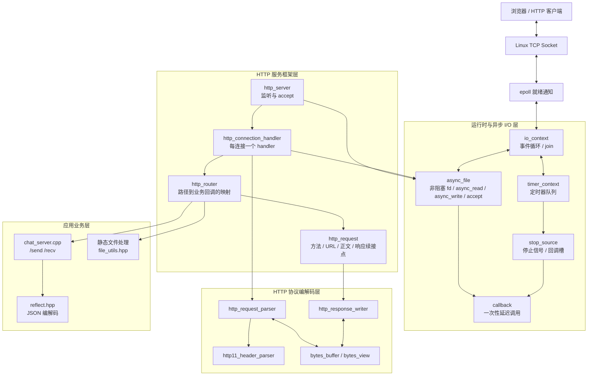

这张图应按“职责层”来读，而不是理解成每个箭头都代表一次函数调用：

- 网络数据先由内核放入 socket 接收缓冲区；epoll 只通知“这个 fd 现在可能可读/可写”。
- `io_context` 收到就绪事件后，恢复 `async_file` 注册的回调。
- `async_file` 再执行 `read()` / `write()` 等系统调用，并把结果交给上层回调。
- `http_connection_handler` 将读取到的字节推给 parser；请求完整后再交 router。
- 业务回调决定立即响应，还是暂时保留请求、稍后响应。


### 1.2 主要模块依赖图

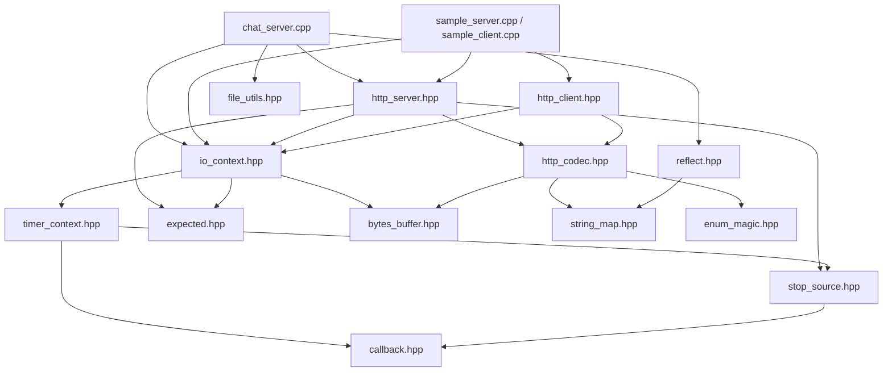

理解依赖关系时，可以把 `http_server.hpp` 看成 HTTP 框架入口，把 `io_context.hpp` 看成异步运行时入口，把 `http_codec.hpp` 看成协议边界。`chat_server.cpp` 是应用层示例，不应把聊天业务逻辑误认为 HTTP 框架本身的一部分。


### 1.3 模块职责速览

| 模块 | 核心职责 | 不负责什么 |
|---|---|---|
| `io_context` | epoll、事件循环、定时器驱动 | 不解析 HTTP 报文 |
| `async_file` | fd RAII、非阻塞 read/write/accept/connect | 不决定业务逻辑 |
| `timer_context` | 按到期时间管理回调 | 不理解请求或连接状态 |
| `callback` | 类型擦除、保存和调用延迟任务 | 不提供线程调度 |
| `stop_source` | 共享停止状态，并触发一个停止回调 | 不是多等待者广播器 |
| `http_codec` | HTTP 起始行、头部、正文解析与写入 | 不负责 socket 就绪等待 |
| `http_connection_handler` | 单连接读、解析、路由、写和复用 | 不处理所有连接的全局调度 |
| `http_router` | 根据 URL 路径查找业务回调 | 不做完整 REST 路由匹配 |
| `chat_server.cpp` | `/send`、`/recv` 与消息存储 | 不属于通用 HTTP 协议层 |

---


## 2. 服务启动与连接建立


### 2.1 从 `main()` 到监听 socket

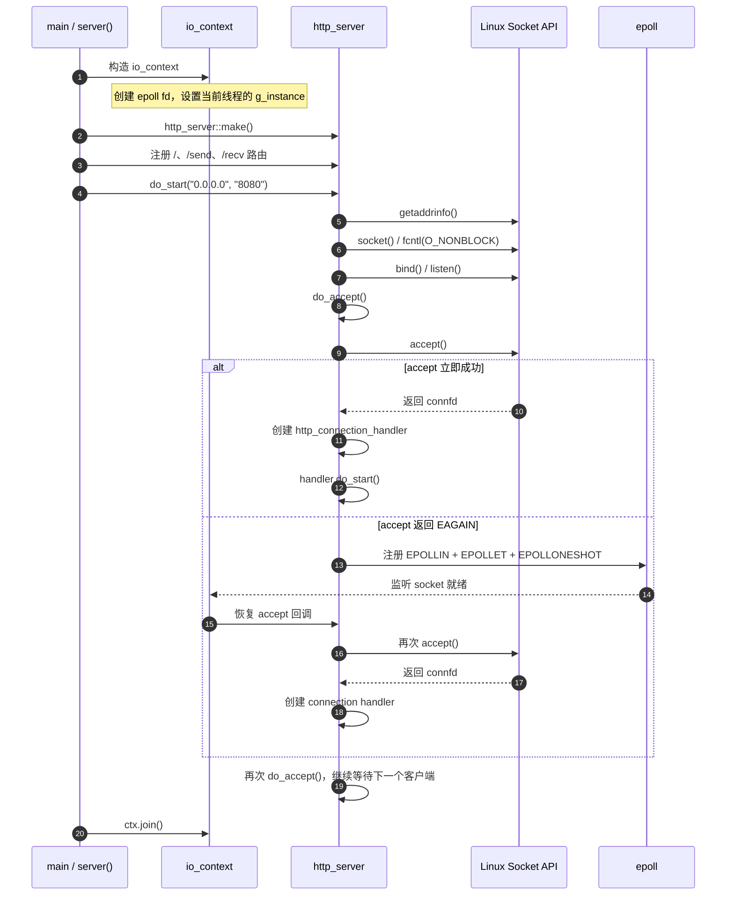

`do_accept()` 的回调在连接成功后创建一个新的 `http_connection_handler`，随后再次调用 `do_accept()`。所以监听 socket 的 accept 链持续存在；每个成功 accept 的客户端则拥有自己的连接处理对象。


### 2.2 多连接模型：一个事件循环，多个连接对象


**并发模型要这样理解：**

- 可以同时维护很多连接，每个连接都能等待自己的 I/O 事件或定时器。
- 但默认只有一个事件循环线程执行这些回调；同一时刻不是多个业务回调在多个 CPU 核上并行运行。
- 当某个回调执行较长的同步逻辑时，其他连接的回调只能等待这个回调返回。
- 因此，“单线程事件驱动”解决的是大量连接等待 I/O 时的线程成本，并不自动解决 CPU 密集计算和同步文件操作造成的阻塞。

---


## 3. `io_context` 与 `async_file`：异步发生


### 3.1 事件循环的核心职责

`io_context::join()` 的逻辑可以压缩成下面这张图：

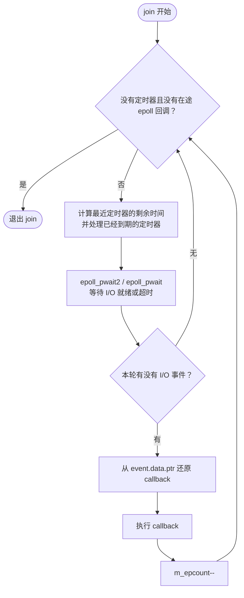

两个退出条件：

- 定时器队列为空；
- 当前登记的 epoll 回调数量 `m_epcount` 为零。

`duration_to_next_timer()` 不只是“读取超时时间”。它会检查队首定时器；若已经到期，就先移除并执行回调，然后再计算下一个定时器。


### 3.2 `async_read()` 并不是一调用就一定进入 epoll

这是读懂本项目异步 I/O 的关键。`async_read()` 首先尝试直接执行一次非阻塞 `read()`：


含义：

- **数据已经在内核接收缓冲区里**：非阻塞 `read()` 可能立即返回，用户回调也会在当前调用链中立即执行。
- **当前没有数据**：`read()` 返回 `EAGAIN`，才把回调登记到 epoll，等内核通知。
- **事件到来后**：不是 epoll 直接把数据交给 parser，而是恢复回调；回调再次调用 `read()`，真正读取数据。

所以 `async_read()` 是“先试一次，不能完成才等待”，而不是传统意义上调用后必然排队、稍后再回调。


### 3.3 `EPOLLET` 与 `EPOLLONESHOT` 的配合

默认代码路径（`USE_LEVEL_TRIGGER` 未启用时）注册的关注事件包含：

- `EPOLLIN`：可读；
- `EPOLLOUT`：可写；
- `EPOLLERR`：错误事件；
- `EPOLLET`：边沿触发；
- `EPOLLONESHOT`：一次通知后暂时禁用，需重新注册/修改后再接收下一次通知。

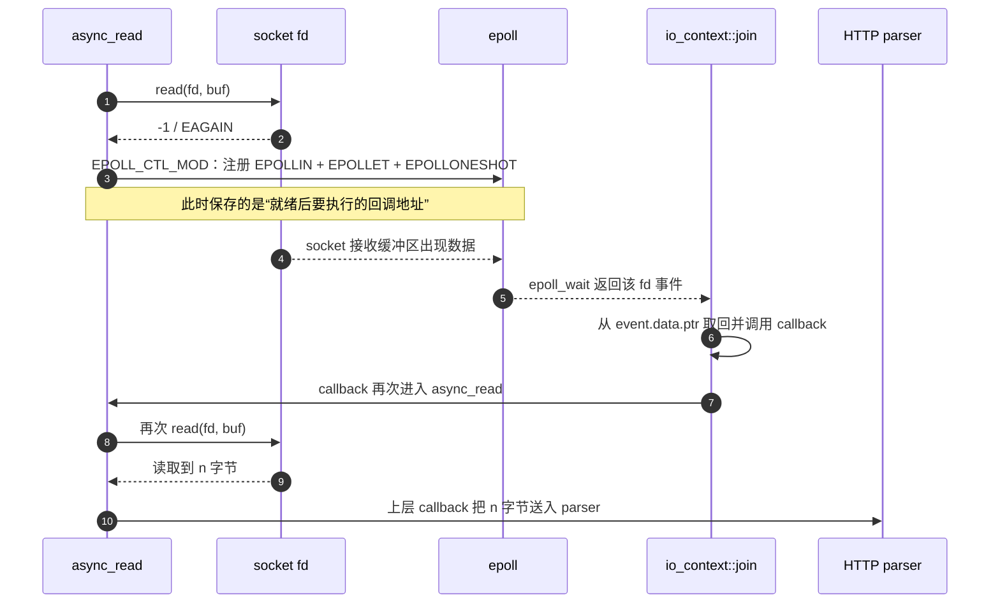

边沿触发下，程序通常要持续读到 `EAGAIN` 才算把当前可读数据处理干净。本项目通过“读到数据就调用上层回调，而上层 `do_read()` 又继续发起下一次 `async_read()`”形成连续读取链，最终在没有更多数据时遇到 `EAGAIN`，重新挂到 epoll。

写入也采用相同思想：先 `write()`；遇到 `EAGAIN` 才等待 `EPOLLOUT`。如果只写出一部分，上层 `do_write()` 用剩余视图继续写。


### 3.4 定时器与 I/O 的竞速

`timer_context` 使用 `std::multimap<steady_clock::time_point, _timer_entry>`，按到期时刻排序。


这里的命名容易误导：`timer_context::set_timeout()` 传入的 `stop_source` 在被请求停止时，会把定时器摘除并执行定时器回调。它不是一个“静默丢弃定时器回调”的普通取消接口。理解这一点，才能看懂 `do_read()` 中读超时与读完成的互斥关系。

---


## 4. HTTP/1.1 报文：协议结构与本项目实现范围


### 4.1 一条 HTTP 请求由哪些部分组成

示例请求：

```http
POST /send HTTP/1.1
Host: 127.0.0.1:8080
Content-Type: application/json
Content-Length: 30

{"user":"A","content":"hi"}
```

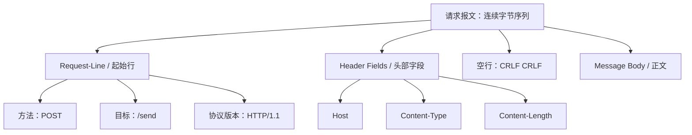

请求行的基本结构：

```text
METHOD SP request-target SP HTTP-version CRLF
```

响应报文使用状态行，例如：

```http
HTTP/1.1 200 OK
Server: co_http
Content-Type: text/plain;charset=utf-8
Connection: keep-alive
Content-Length: 2

OK
```

响应的结构是：状态行、头部字段、空行、正文。**HTTP 报文边界由 HTTP 规则决定，不由 TCP 包边界决定。**


### 4.2 HTTP 字节流与 TCP 读分片不是一回事

TCP 提供的是有序字节流，不承诺一次 `send()` 对应一次 `read()`。例如客户端发送：

```text
[请求头 1][请求头 2][正文前半][正文后半]
```

服务端可能观察到下面任意一种读取结果：

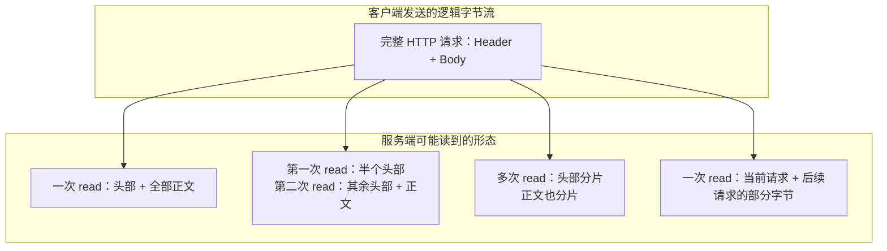

因此 parser 必须维护跨多次 `read()` 的解析状态：

- 头部没收完整：继续追加字节，寻找 `\r\n\r\n`。
- 头部收完整：计算正文长度，并保留同一次读取中已经读到的正文部分。
- 正文没收完整：继续读，累积正文。
- 正文达到指定长度：请求才算完整，可以进入路由。


### 4.3 本项目的两层解析器


关键成员的含义：

| 成员 | 意义 |
|---|---|
| `m_header` | 还在解析的 HTTP 头部字节 |
| `m_headline` | 请求行或状态行 |
| `m_header_keys` | 解析后的头字段映射，键名转小写 |
| `m_body` | 头部结束符之后、同批读取中已经多读到的正文字节 |
| `m_content_length` | 从头部提取的正文长度 |
| `body_accumulated_size` | 已累计的正文长度 |
| `m_body_finished` | 正文是否达到完成条件 |

注意：`request_finished()` 代表 HTTP parser 已经判定请求完整，不代表 socket “可读”。socket 可读只是 I/O 层事件；HTTP 请求完整是协议层状态。


### 4.4 一个分片解析示例

假设请求头声明 `Content-Length: 10`，正文是 `0123456789`：

```text
第 1 次 read：POST /send HTTP/1.1\r\nContent-Len
                 ↓
             未找到完整的 CRLF CRLF
             parser 保留头部，继续读

第 2 次 read：gth: 10\r\n\r\n0123
                 ↓
             找到头部结束符
             提取 Content-Length = 10
             当前 body = "0123"，已累计 4 字节
             4 < 10，继续读

第 3 次 read：456789
                 ↓
             body 变为 "0123456789"
             已累计 10 字节
             request_finished() = true
             进入 do_handle()
```

这就是增量解析：不用等整个请求一次性抵达才开始解析头部；每次新数据到达后，只推进尚未完成的协议状态。

### 4.5 `Content-Length` 与 `Transfer-Encoding: chunked`

HTTP/1.1 的消息长度不只由 `Content-Length` 决定。RFC 9112 还定义了 `Transfer-Encoding: chunked` 的分块消息定界方式；chunked 正文通过每块的十六进制长度和最终零长度块判断结束。

本项目当前的 `_http_base_parser` 只从 `content-length` 取长度：

```text
有 Content-Length: N  → 累积到至少 N 字节后认为正文完成
没有 Content-Length    → 按 0 字节处理
没有 chunked 解码状态机
```

所以它是教学用途的简化解析器，不是完整 HTTP/1.1 报文解析器。不要把“本项目的 parser 能处理”理解成“HTTP/1.1 标准只允许这样处理”。

### 4.6 头部解析的实际限制

源码中的头部字段分隔查找使用 `": "`，即要求冒号后面紧跟一个空格；它还没有实现完整的字段语法校验、重复字段合并和严格错误响应。头字段名称转小写，有利于大小写不敏感查找，但这不等于完整实现了 HTTP 头部语法。

---


## 5. 从一次 HTTP 请求到响应写回：完整时序

下面是最应该反复对照源码阅读的一张图。它把网络层、事件循环、HTTP parser、router 和业务回调放到同一条时间线上。

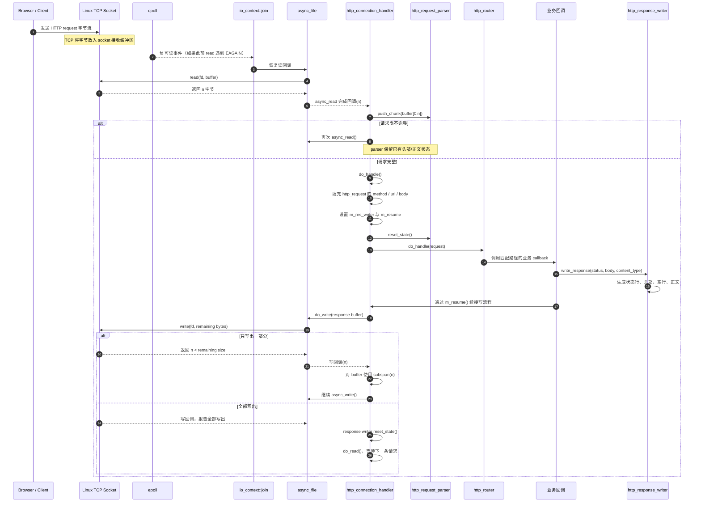


### 5.1 四个关键函数各自做什么

| 函数 | 输入 | 核心动作 | 结束后进入 |
|---|---|---|---|
| `do_read()` | socket 上的新字节 | 读数据、取消本轮空闲定时器、推进 parser | 不完整则继续读；完整则 `do_handle()` |
| `do_handle()` | 已完整的 parser 状态 | 抽取 method/url/body，设置响应续接点，重置 parser，调用 router | 业务回调 |
| `write_response()` | status、content、content-type | 构造 HTTP 响应报文，调用 `m_resume()` | `do_write()` |
| `do_write()` | 待写的字节视图 | 异步写出；处理部分写入 | 写完后 `do_read()` |

这里的 `m_resume` 是一个非常重要的设计点：业务层不需要直接调用 socket 写操作，而是通过请求对象中保存的续接回调，把控制权交还给连接 handler。

---


## 6. 连接状态机与 keep-alive


### 6.1 单连接的逻辑状态机

源码没有显式定义一个 `enum class ConnectionState`，但调用关系形成了一个隐式状态机：

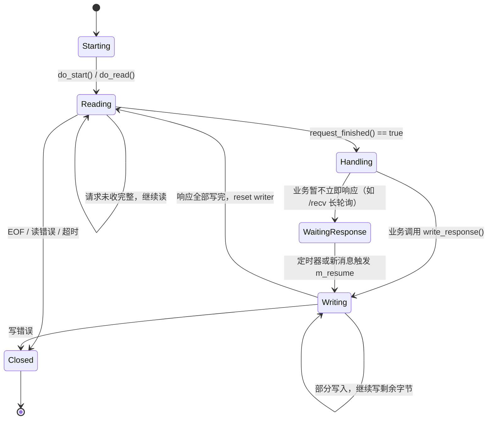

“等待业务响应”是逻辑状态，不是源码里的独立状态变量。长轮询时，连接没有继续读，也没有立即写，而是保留当前 request，等定时器或新消息触发响应。


### 6.2 读阶段的 10 秒空闲超时

`do_read()` 为一次等待读取同时建立两条路径：

- `stop_io`：用于触发/停止当前读操作；
- `stop_timer`：用于移除本轮 10 秒定时器。

读先完成时，读操作先清理自己的停止回调，再请求停止定时器；定时器回调被触发时只会尝试停止已经完成的读，不会再次完成同一次读。超时先到时，定时器回调请求停止 I/O，读回调收到 `-ECANCELED` 后退出。

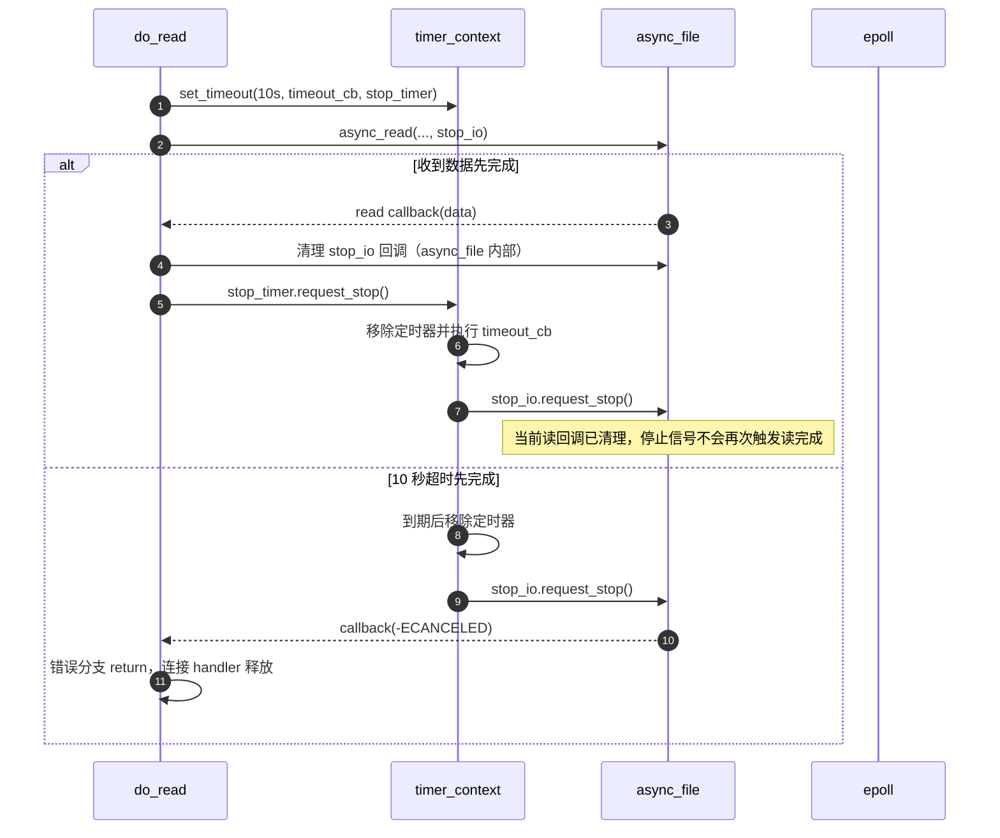


### 6.3 keep-alive 的真实含义

HTTP/1.1 默认采用持久连接：一条 TCP 连接可以承载多组请求与响应。连接复用不是“同一请求反复读取”，而是：

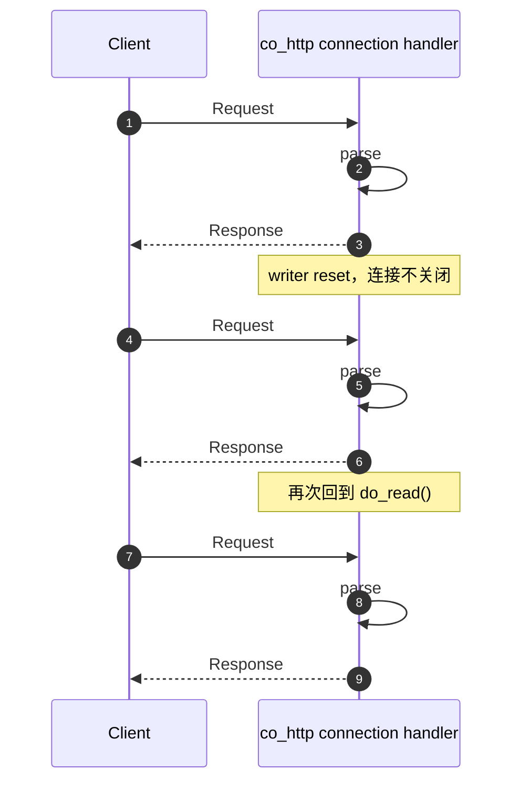

在本项目中，keep-alive 的代码实现主要是：

1. 响应头固定写入 `Connection: keep-alive`；
2. 响应全部写完后重置 `m_res_writer`；
3. 再次调用 `do_read()`，不主动关闭连接。

但它没有完整处理连接管理语义：例如没有根据请求中的 `Connection: close` 决定响应后关闭；超时、EOF 或读写错误时则释放连接。


### 6.4 keep-alive 不等于 pipelining

两者必须区分：

- **Keep-alive**：一条连接上前一个响应完成后，客户端再发送下一条请求。
- **Pipelining**：客户端不等待前一个响应，就连续发送多条请求；服务端仍需按请求顺序对应响应。

当前 `http_connection_handler` 的主流程是“读完整条请求 → 处理 → 写完响应 → 再读下一条请求”。这支持顺序复用，但不等于支持完整的 HTTP/1.1 pipelining。

另一个源码边界是：`http11_header_parser` 把头部结束符之后同一次 `read()` 多读到的字节放进 `m_body`，但 `_http_base_parser` 只判断累计正文是否达到 `Content-Length`，没有把超过当前请求正文长度的剩余字节保存为下一条请求的输入。因此，如果一次读取跨过当前正文边界、把下一条请求也读进来，额外数据可能混入当前请求 body；这不是完整的流水线解析实现。

---


## 7. 响应生成与部分写入


### 7.1 响应从业务对象变成网络字节


`async_write()` 也会先尝试直接执行 `write()`。如果只写出一部分，`do_write()` 负责推进剩余视图；如果内核发送缓冲区暂时不可写，`async_file` 才通过 `EPOLLOUT` 等待下一次可写事件。


### 7.2 为什么不能提前 reset writer

`do_write()` 接收的是 `bytes_const_view`，它只是对内存的非拥有视图。实际响应字节仍由 `m_res_writer` 内部的 `bytes_buffer` 持有。

所以必须满足：

- 整个异步写入过程中，`m_res_writer` 及其 buffer 仍然存活；
- 不得在写完之前调用 `reset_state()`；
- 不得在 buffer 发生扩容或清空后继续使用旧视图。

这也是 `do_write()` 在全部写完后才 reset writer 的原因。

### 7.3 当前响应状态行的一个实现限制

`http_response_writer::begin_header(status)` 固定把 reason phrase 写成 `OK`。因此 404 响应可能被序列化为：

```http
HTTP/1.1 404 OK
...
```

状态码仍然是 404，但原因短语不准确。它不影响浏览器主要依据状态码识别响应的常见场景，却表明该 writer 仍是简化实现。

---


## 8. `/send` 与 `/recv`：长轮询业务时序


### 8.1 `/send`：写入消息并触发等待者

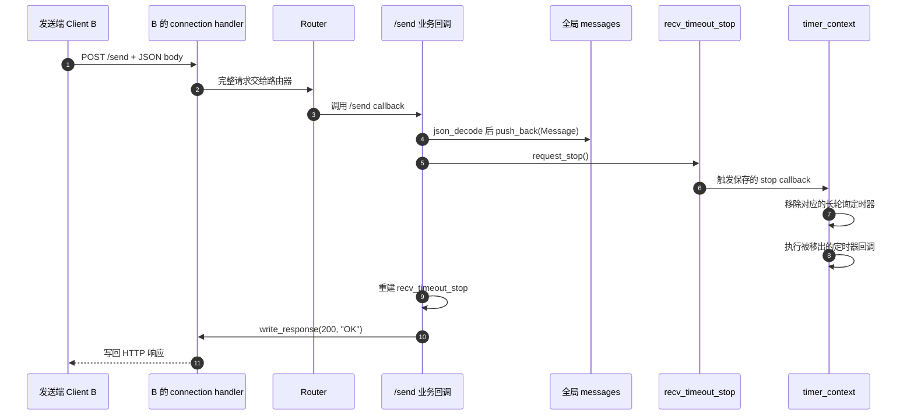


### 8.2 `/recv`：立即返回路径


### 8.3 `/recv`：没有新消息时挂起

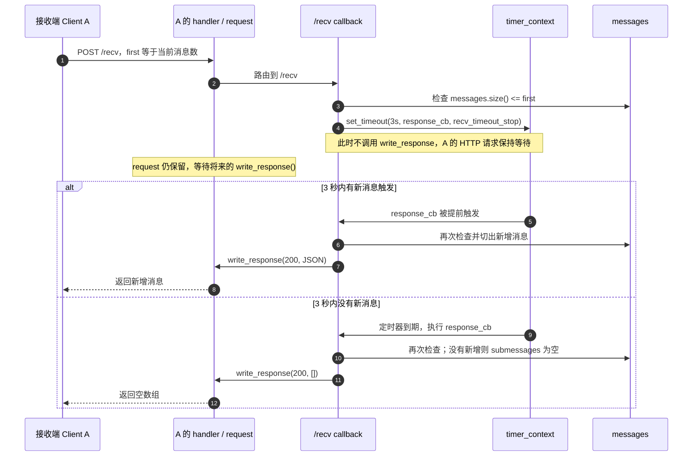


### 8.4 两个客户端同时长轮询：单槽覆盖问题

`stop_source` 的控制块只有一个 `m_cb`，`set_stop_callback()` 是覆盖式赋值，不是回调列表。`chat_server.cpp` 中多个 `/recv` 请求共用一个全局 `recv_timeout_stop`，因此：

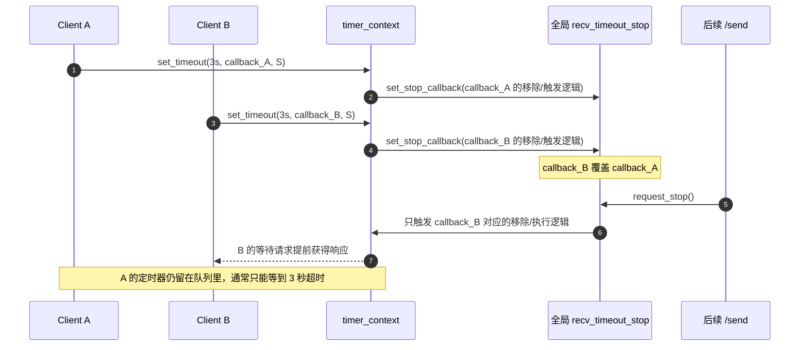

所以当前示例在单个长轮询请求时能展示“消息到达后立即唤醒”；但多个客户端同时等待时，不能保证所有等待请求都被一次 `/send` 立即唤醒。若要支持多个等待者，需要为每个等待请求独立的取消/唤醒控制块，或维护等待者集合，而不是共用单槽 callback。

---


## 9. 对象生命周期与回调所有权


### 9.1 每个连接 handler 持有哪些核心对象

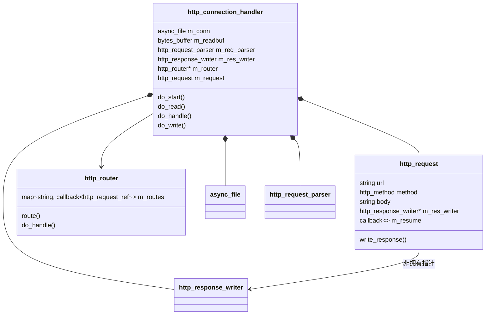

一个连接 handler 持有该连接自己的 socket、读缓冲区、parser、writer 和 request。Router 是服务器共享的路由表，多个连接 handler 通过指针访问它。


### 9.2 `shared_from_this()` 为什么重要

异步 I/O 发起之后，函数会返回；真正执行回调时，原来的栈帧可能早已结束。因此不能只捕获一个裸 `this`，再假定对象一直存在。

本项目在 I/O 回调中捕获 `shared_from_this()`，让连接 handler 至少存活到回调执行。更特别的是，`do_handle()` 会设置：

```text
m_request.m_resume = [self = shared_from_this()] {
    self->do_write(self->m_res_writer.buffer());
};
```

这让 request 的响应续接回调持有 handler。若 `/recv` 长轮询没有立刻响应，handler 仍能存活；之后定时器回调通过 `&request` 调用 `write_response()`，再由 `m_resume` 进入写流程。


这里的设计效果是延长对象生命周期，但也有相应约束：如果业务路径永远不调用 `write_response()`，`m_resume` 持有的 `shared_ptr` 可能使 handler 无法释放。因此，长轮询、超时、异常和客户端断开等路径都必须正确收尾。


### 9.3 一次性 callback 与多次路由 callback

`callback<Args...>` 内部用 `unique_ptr` 保存类型擦除后的可调用对象：

- 普通 `operator()(args...)`：调用后把内部指针清空，因此是一次性回调。
- `operator()(multishot_call, args...)`：调用但不清空，供需要复用的路由处理器使用。

这两个调用方式不是语法装饰，而是所有权语义：一次性 I/O 完成事件不应重复执行；一个已经注册的路由回调则需要服务同一路径的后续请求。

---


## 10. 当前实现边界与学习时要留意的点

下表区分“项目实际实现”和“HTTP/网络系统通常需要的完整能力”。这里列出的是读源码时应明确记住的边界，不是说这个教学项目没有价值。

| 项目 | 当前源码表现 | 学习时的正确理解 |
|---|---|---|
| HTTP 版本 | 代码围绕 HTTP/1.1 报文格式编写，但请求解析主要抽取方法和 URL | 不应认为它完成了严格的版本校验 |
| 正文定界 | 主要使用 `Content-Length` | 没有完整实现 Transfer-Encoding / chunked |
| Content-Length 缺失 | 按 0 处理 | 这是本项目简化策略；不是所有请求体都能由它解析 |
| TCP 粘包/分片 | parser 支持跨多次 read 累积头部和正文 | 能处理分片不等于支持流水线剩余数据管理 |
| Pipelining | 没有完整的多请求缓冲和逐条消费机制 | keep-alive 与 pipelining 是两种不同能力 |
| 头字段语法 | 按 `": "` 分隔，并将 key 转小写 | 不是完整的 HTTP field-line 语法解析器 |
| 路由 | `std::map` 按 URL 字符串精确查找 | 没有按 HTTP method、参数模式或通配符做完整路由匹配 |
| 响应原因短语 | 固定写 `OK` | 例如 404 状态行会出现 `404 OK` |
| Connection 头 | 响应固定写 `keep-alive` | 未完整按请求的 `Connection: close` 管理生命周期 |
| 长轮询唤醒 | 全局 `stop_source` 只有一个 callback 槽位 | 多个等待者可能覆盖彼此的唤醒回调 |
| 业务线程 | 业务回调运行在事件循环线程 | 同步 JSON、同步文件读取或长计算会延迟其他连接 |
| 错误处理 | 示例业务的 JSON 解码路径缺少统一异常边界 | 不应把示例代码当成生产级错误隔离模型 |


### 10.1 另一个底层审查点：初始 epoll 注册

`async_file` 构造时先把 fd 设为 `O_NONBLOCK`，并通过 `EPOLL_CTL_ADD` 注册 `EPOLLET`，此时 `event.data.ptr` 初始化为 `nullptr`。真正发起异步操作并遇到 `EAGAIN` 后，`_epoll_callback()` 再通过 `EPOLL_CTL_MOD` 把 callback 地址和 `EPOLLIN` / `EPOLLOUT` 等事件写进去。

因此，在 fd 初始注册与具体 I/O callback 完成注册之间，如果发生异常事件（例如某些连接复位路径），事件数据指针可能还没有指向有效 callback。原分析文件已指出这条风险；源码中的 `event.data.ptr = nullptr` 与后续 MOD 注册过程也能对应上。


### 10.2 `m_epcount` 与取消路径的计数一致性

`_epoll_callback()` 在登记 epoll callback 后递增 `m_epcount`；`io_context::join()` 只在从 `epoll_wait` 取出事件并调用 callback 后递减计数。停止操作则通过 `stop_source` 直接调用已保存的 callback。**直接取消路径没有在这段代码中看到对应的 `m_epcount--`**，因此如果某个等待操作被取消、且没有随后通过 epoll 事件完成，`m_epcount` 可能与实际仍在等待的事件数量不一致。它主要影响 `is_empty()` / `join()` 的退出计数语义，也说明这个简化的取消实现需要进一步审查。

### 10.3 同步业务操作可能阻塞整个事件循环

聊天业务中，`file_get_content()`、JSON 反射编解码、`messages` 容器操作都在事件循环回调中执行。尤其是静态文件同步读取：文件系统操作没有被转换成异步文件 I/O。因此，当前模型适合教学与小型演示，但不能仅凭 socket I/O 非阻塞，就断言整个请求处理链都不会阻塞。

---


## 11. 推荐的源码阅读顺序

按“先知道控制权如何流动，再理解字节如何解释”的顺序阅读，会比逐个头文件从上往下读更容易建立模型：

1. **`chat_server.cpp`**：先看 `/`、`/send`、`/recv`，明确 HTTP 框架最终要支持什么业务。
2. **`http_server.hpp`**：重点读 `http_server`、`http_router`、`http_request`、`http_connection_handler`，建立连接状态机。
3. **`http_codec.hpp`**：读 `http11_header_parser`、`_http_base_parser`、`http_request_parser`、`http_response_writer`，理解字节怎样变成请求和响应。
4. **`io_context.hpp`**：读 `io_context::join()`、`async_file::_epoll_callback()`、`async_read()`、`async_write()`，还原非阻塞 I/O 的真实调用路径。
5. **`timer_context.hpp`、`stop_source.hpp`、`callback.hpp`**：理解定时器提前触发、一次性 callback 和单槽停止回调。
6. **`bytes_buffer.hpp`、`expected.hpp`、`reflect.hpp`**：最后研究内存视图、错误表示和 JSON 编解码。

建议每读完一个模块，都回答三个问题：

- 它持有什么状态？
- 它把控制权交给谁？
- 它在什么条件下完成、挂起或失败？

这三个问题能把类、函数、回调、状态机和时序流连成一个整体。

---


## 12. 参考源码与协议资料

### 项目源码

- [仓库主页与 README](https://github.com/archibate/co_http)
- [`http_server.hpp`](https://github.com/archibate/co_http/blob/master/http_server.hpp)：server、router、request、connection handler
- [`http_codec.hpp`](https://github.com/archibate/co_http/blob/master/http_codec.hpp)：HTTP parser / writer
- [`io_context.hpp`](https://github.com/archibate/co_http/blob/master/io_context.hpp)：epoll、async_file、事件循环
- [`timer_context.hpp`](https://github.com/archibate/co_http/blob/master/timer_context.hpp)：定时器队列
- [`callback.hpp`](https://github.com/archibate/co_http/blob/master/callback.hpp)：一次性和多次调用 callback
- [`stop_source.hpp`](https://github.com/archibate/co_http/blob/master/stop_source.hpp)：停止控制块
- [`chat_server.cpp`](https://github.com/archibate/co_http/blob/master/chat_server.cpp)：聊天业务和长轮询
- [`http_client.hpp`](https://github.com/archibate/co_http/blob/master/http_client.hpp)：客户端与连接复用实现


### HTTP 标准

- [RFC 9112 — HTTP/1.1](https://www.rfc-editor.org/rfc/rfc9112.html)：HTTP/1.1 报文语法、消息定界、chunked 编码、连接管理与持久连接。

**建议记住的标准/实现分界**：RFC 描述完整 HTTP/1.1 的协议规则；本项目只实现其中用于教学示例的一部分。分析源码时先写“它实际上做了什么”，再对照 RFC 写“完整协议还要求什么”，不要用标准行为替项目补全不存在的实现。
