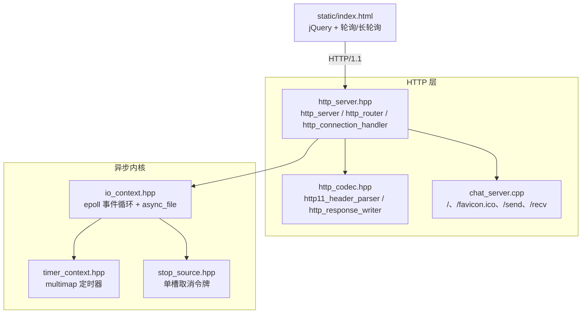

# 服务器演进设计方案（v1）

> **文档性质**：设计方案 + 决策记录（ADR），**不含实现代码**，本轮不改动代码与项目结构。
> **范围**：**服务器演进**——稳定性、HTTP 协议正确性、C++20 协程架构、工作窃取调度器、性能实验、工程化、版本管理。UI/交互设计不在本文范围，见 `docs/design-ui-and-evolution.md`。
> **基线**：`master @ 65b0171`（2026-11-10）；项目为教学型聊天服务器（单线程 epoll + 回调 + 长轮询，C++17，GCC 14 / Ubuntu 22.04）。
> **版本**：**v1（2026-11-11）**；版本与 git 工作流见 §5，本次记录见 §5.4。
> **证据**：§1 的结论全部来自对当前源码的逐行核对（文件:行号见附录 A）；原设计文档 §8 与附录 A 的实测数据只作参考（本轮未重跑，见 §1.5）。

---

## 0. 结论

一句话：**先不崩（P0）→ 协议对（P1）→ 在同一个异步内核上引入 C++20 协程与工作窃取调度器（P2）→ 可量化的性能（P3）→ 工程化与可选演进（P4）**。

现有回调实现（单线程模型）**保留、先修好，作为对照组**；协程版以**新增编译目标**并存，不替换默认实现。底层只重构 3 个头文件（事件分发、定时器、取消语义），**复用** HTTP 编解码、字节缓冲、JSON 反射和聊天业务语义——这是"目标不变、改动最小"的落点。

### 0.1 优先级总表（重排后）

| 级别 | 主题 | 目标（一句话） | 关键产出 | 预估 |
|---|---|---|---|---|
| **P0** | 稳定性 | 畸形输入 / 对端 RST / 资源耗尽**不再杀进程**，可安全长跑 | 事件分发去裸指针 + 异常边界 + 上限与 deadline + 优雅退出 | 2–3 人日 |
| **P1** | 协议正确性 | 满足 HTTP/1.1 最小可用子集，前端可以放心依赖 | method+path 路由、HEAD、Date、query 拆分、pipelining 不丢 | 2–3 人日 |
| **P2** | 架构（协程 + 调度器） | 用 C++20 协程重写 I/O 与连接状态机；保留回调版对照 | `Task`/awaiter/操作槽 + work-stealing + 协程 HTTP | 5–8 人日 |
| **P3** | 性能与可量化实验 | 有数据、可复现的优化；静态交付"秒开" | 缓存/ETag/304/gzip/sendfile + 压测矩阵与报告 | 2–3 人日 |
| **P4** | 工程化与演进 | 可交付、可观测、可扩展；选做按教学收益排序 | 测试/CI/日志/配置/容器/优雅退出；SSE→WS 等 | 2–5 人日 |

> 与原文档的差异：旧文档把性能放 P2、协程放 P4"选做"、工程化放 P3。本方案按"先稳定正确、再架构、再性能、最后工程化/演进"重排，**协程提升为 P2 主线**（用户目标），性能实验后移但**基线数据在 P0/P1 阶段就开始积累**。详见 §3.9 映射表。

### 0.2 关键决策（详见 §7）

| 编号 | 决策 |
|---|---|
| D1 | 现有回调实现**保留**为对照组；不删除、不改变其业务语义 |
| D2 | 协程版是**新增 target**（`chat_server_co`），默认 `chat_server` 暂不替换 |
| D3 | 两版**共用**编解码 / 缓冲区 / JSON / 业务状态，只有 I/O 与连接状态机不同 |
| D4 | epoll 事件分发用 **fd→操作槽** 取代 `data.ptr` 裸回调指针（P0 根因） |
| D5 | 取消统一为"操作级令牌 + 恰好恢复一次"；取消后必须**解除 epoll 武装** |
| D6 | 调度器 = 单 I/O 线程（epoll） + N 个 work-stealing worker（只跑 CPU 任务；co_async 本身**未实现** work-stealing，此策略为本方案自建，见 §4.0） |
| D7 | 长轮询改用 **hub/Channel 广播**，废弃全局单槽 `stop_source` |
| D8 | 版本管理：设计版本 `design-vN` 与代码里程碑版本分离（§5） |

---

## 1. 代码核实：先证明"问题真实存在"，再谈演进

### 1.1 现状架构（30 秒版）



连接模型：`accept` → 每连接一个 `http_connection_handler` → `async_read` 读满一个请求 → `http_router` 按 URL **精确匹配** → 业务写响应 → `async_write` → 回到读（keep-alive）。长轮询 = 业务不立刻响应，注册 3 秒定时器，由 `/send` 通过全局 `stop_source` 唤醒。

### 1.2 对原文档 §8 主张的逐条核实

| # | 原文档主张 | 代码证据 | 结论 |
|---|---|---|---|
| 1 | 非法 JSON 一次 → 进程 terminate | `reflect.hpp:1144-1150` 抛 `system_error`；`chat_server.cpp:51` 直接调用；`io_context.hpp:62` 执行续体无 try/catch；`chat_server.cpp:87-92` main 未捕获 | **属实** |
| 2 | 长轮询中 RST → SIGSEGV | `io_context.hpp:216-221` 构造时 `EPOLL_CTL_ADD(EPOLLET, data.ptr=nullptr)`；`io_context.hpp:256-264` 首次 `read()` 立即成功时**不经过** `_epoll_callback`，`data.ptr` 仍是 nullptr；`io_context.hpp:61-62` 事件到达后 `from_address(nullptr)` 并调用 | **属实，但根因需修正**：崩溃条件是"事件到达时该 fd 未挂任何在途回调指针"，典型场景是**请求在首次 read 立即成功**；`EPOLLONESHOT` 已消费后不会重复投递 |
| 3 | `HEAD /` 返回正文 | `http_server.hpp:42-54` 恒写 body；`http_server.hpp:68-76` 路由不看 method | **属实** |
| 4 | pipelining 丢第二个请求 | `http_server.hpp:103-141` 一次读只解析一个请求；`http_server.hpp:152` `reset_state()` 清掉 parser 里剩余字节；`http_codec.hpp:216-234` 只按 Content-Length 截断 | **属实** |
| 5 | `GET /?x=1` → 404 | `http_codec.hpp:264-266` `url()` 返回完整 target；`http_server.hpp:60` `std::map` 精确匹配 | **属实** |
| 6 | `404 OK`、无 Date、Connection 写死 | `http_codec.hpp:363-369` reason 固定 `OK`；`http_server.hpp:46-51` 固定四个头 | **属实** |
| 7 | 2MB 请求头无 431 | `http_codec.hpp:70-89` 头部字节无界 `append`，无上限检查 | **属实** |
| 8 | 1MB URL 无 414 | 全仓库无 URL 长度检查 | **属实** |
| 9 | slowloris 每 9 秒 1 字节可永久挂住 | `http_server.hpp:106-113` 每次 `do_read()` 新建 10 秒定时器，读成功即重置 | **属实** |
| 10 | 200 并发空闲连接全部接受 | `http_server.hpp:197-205` 无连接数上限与降级 | **属实** |
| 11 | 基线约 670–735 rps | README 记录 698 req/s；本轮未复测 | **与 README 一致，待复测** |
| 12 | 5 条声明 100MB body 的慢连接约 10 秒关闭且无 408/413 | 与 10 秒读超时、无 413 的代码一致 | **属实（无协议响应）** |
| 13 | `m_epcount` 取消路径不自减 | `io_context.hpp:233` 注册时 `++`；`io_context.hpp:234-236` 取消时执行续体但**不减**；`io_context.hpp:63` 只在 epoll 事件后减 | **属实** |
| 14 | 全局单槽 `stop_source`，多等待者只有最近一个被唤醒 | `stop_source.hpp:52-57` 单槽覆盖；`chat_server.cpp:30,52-53,76` 全局令牌 | **属实** |
| 15 | `data.ptr=nullptr` 空回调 → 崩溃 | 见 #2 | **属实** |

### 1.3 原文档漏掉 / 说轻了的问题（新增 N1–N9）

| 编号 | 问题 | 证据 | 影响 |
|---|---|---|---|
| N1 | **取消回调同步执行**：`request_stop()` 在任意调用栈里直接执行续体 | `stop_source.hpp:40-49`；`timer_context.hpp:33-37` | 重入顺序不可控；协程化后若在 I/O 回调里同步恢复协程，会形成同步递归与深栈 |
| N2 | **取消后 epoll 注册未解除武装**，且 `data.ptr` 指向已释放回调 | `io_context.hpp:225-237` 只 MOD 不回退；`io_context.hpp:233-236` | 当前靠"同一线程顺序执行 + 连接随即关闭"侥幸不炸；协程化后必现 UAF |
| N3 | `accept` 失败用 `expect` 直接抛 | `http_server.hpp:200` | EMFILE/ENFILE 一类资源耗尽 → terminate，可被远程打崩 |
| N4 | 无 SIGPIPE 处理 | 全仓库 grep 无 `SIGPIPE`/`MSG_NOSIGNAL` | 向已 RST 连接写 → 默认动作终止进程 |
| N5 | 定时器/事件循环错误路径用 `expect` | `io_context.hpp:46-58`（epoll_wait）、`io_context.hpp:30` 等 | EINTR 会抛异常；未来加 SIGINT/SIGTERM 必须处理 |
| N6 | 长轮询定时器捕获裸 `&request` | `chat_server.cpp:67`；保活依赖 `http_server.hpp:149-151` 的 `m_resume` 自引用 | 业务路径漏调 `write_response` 即永久泄漏 handler 与 fd |
| N7 | 静态文件每次请求同步读盘 | `chat_server.cpp:39-47`；`file_utils.hpp:11-18` | 事件循环被文件 I/O 阻塞；文件缺失直接抛异常（进 N3 同类路径） |
| N8 | 头部语法只认 `": "`，且无字段数/长度上限 | `http_codec.hpp:50`；无计数检查 | 合法但少见的头部被忽略；头部炸弹无保护 |
| N9 | `io_context::get()` 标注 `[[gnu::const]]` 却返回线程局部指针 | `io_context.hpp:75-78` | 语义不严谨，建议去掉标注（低风险） |

### 1.4 核实结论

1. **原文档方向正确**：P0（不崩）→ P1（协议正确）→ 性能 → 工程化的骨架成立，绝大多数主张经代码核实属实。
2. **需要修正三点**：① 协程不再是"P4 选做"，而是本方案主线（P2）；② 部分根因表述要精确（RST 崩溃 = "事件到达时无在途回调指针"，典型触发是首次 read 立即成功）；③ 取消路径的真正风险不止计数：还有"未解除武装 + 裸指针 + 同步重入"，这三条决定协程内核算法的形状。
3. **原文档的实测数据可复用**（附录 A 来自上一轮 WSL2 实测），但 P0 修复后应把探针**脚本化**，作为回归基线（§6）。

### 1.5 本轮未做的验证（边界声明）

- 本轮在 Windows 侧做**只读核对**，未在 WSL2 重新编译/复现崩溃；原文档附录 A 的测试数据作为输入引用，不作为本轮结论。
- 建议 P0 实施前先补一轮"基线复测"（S0 阶段，§6.1），把崩溃复现变成脚本化用例。

---

## 2. 全盘架构：哪些不动、哪些要改（最小调整）

### 2.1 接缝：只重构"一层"，两端复用


关键判断：**编解码层和业务层与 I/O 完成模型无关**，回调与协程可以共用；真正需要动的是"事件循环怎么把完成事件交还给等待者"。所以重构面收敛到 `io_context` + 少量配套（timer/stop），并在其上提供**两套等价 API**：

- 回调 API（现状，修好后作为基线）：`async_read(buf, cb, stop)`；
- 协程 API（新增）：`co_await conn.read(buf)`。

两者共享同一个**操作槽（operation slot）**：`fd → {events, 续体, 状态}`。这就是"修一次、两版都受益"的最小调整点。

### 2.2 不动清单（保持原样，仅引用）

| 文件 / 部分 | 行数（约） | 为什么不改 |
|---|---|---|
| `http_codec.hpp` 解析/写头核心 | 369 | 与 I/O 模型无关，协程版直接复用；P1 只做**小幅增补**（长度上限、Content-Length 严格性、reason phrase 参数、`: ` 兼容），不改解析结构（≤ 60 行） |
| `bytes_buffer.hpp` / `bytes_view` | 237 | 视图 + 拥有缓冲的抽象已经够用，协程版直接复用 |
| `reflect.hpp` JSON 反射 | 1152 | 非抛出版本已存在（`reflect.hpp:1123-1129`），业务改用即可，不动库 |
| `expected.hpp` | 83 | "-errno + expected" 表示法够用 |
| `string_map.hpp` / `enum_magic.hpp` | 小 | 稳定工具 |
| `http_client.hpp` | — | 与服务器演进无关（除非 P4 做 TLS 实验） |
| `static/*` | — | 前端不在本次范围 |
| 既有两份文档 | — | 记录"代码怎么跑"，本文补"服务怎么演进" |

### 2.3 要改清单（按阶段的**最小**改动）

| 文件 | 改动 | 幅度 | 阶段 |
|---|---|---|---|
| `http_codec.hpp` | P1 增补：头部/URL/body 长度上限、Content-Length 严格性、reason phrase 参数、头部语法兼容 | +60 行，**结构不变** | P1 |
| `io_context.hpp` | 事件分发改 fd→操作槽；注册/取消/完成三态；epoll 解除武装；`post()` 跨线程投递；EINTR 重试 | 核心重构，约 +150/−60 行 | P0 → P2 复用 |
| `timer_context.hpp` | 保留 multimap；增加 `co_sleep_for`/`co_timeout` awaiter；取消回调改为"投递到事件循环"而非同步执行 | +40 行 | P0（重入）/ P2（sleep） |
| `stop_source.hpp` | 修正单槽语义（I/O 取消仍单槽即可，但**不再用于业务广播**）；增加"恰好恢复一次"的状态位 | +25 行 | P0 |
| `http_server.hpp` | P0/P1 修复：异常边界、上限与 deadline、HEAD、method+path 路由、query、pipelining 缓冲；**状态机结构不变** | +120/−40 行 | P0/P1（成为修复后的回调基线） |
| `chat_server.cpp` | 消息环形缓冲 + 单调 id；`chat_hub` 广播唤醒；参数校验；改用非抛 JSON；拆分业务状态到 `chat_business.hpp` | +80/−20 行 | P0 |
| `file_utils.hpp` | 返回 `expected`；启动时缓存静态文件 | +25 行 | P0/P3 |
| `CMakeLists.txt` | C++20（协程 target）、新增 `chat_server_co`、测试/CI 目标 | +20 行 | P2/P4 |
| **新增** `task.hpp` | `Task<T>` / promise / awaiter 基类 | ~180 行 | P2 |
| **新增** `scheduler.hpp` | 工作窃取线程池 + `post`/`co_spawn`/`schedule` | ~250 行 | P2 |
| **新增** `co_http_server.hpp` | 协程连接处理 + `co_router` | ~260 行 | P2 |
| **新增** `chat_server_co.cpp` | 协程版入口与业务 handler（CMake 按文件名自动生成 target `chat_server_co`） | ~120 行 | P2 |
| **新增** `tests/` + CI | conformance / 回归 / sanitizer | ~300 行 | P0/P1 起步，P4 固化 |

> 规模结论：**核心源文件（除 reflect/bearssl/前端）约 1.6k 行；本次只动其中 7 个、净增约 1.5k 行（含新 target 与测试）**。业务语义、协议层、JSON、缓冲区零重写。

### 2.4 双轨策略：回调版是"对照组"，不是"待删代码"

| | 回调版（基线） | 协程版（新架构） |
|---|---|---|
| 目标 | 稳定、正确、可压测；作为对照与回退 | 表达力更强：线性代码替代状态机回调 |
| 文件 | `http_server.hpp`（修复后） | `co_http_server.hpp`（新增） |
| 共享 | `http_codec.hpp`、`bytes_buffer.hpp`、`reflect.hpp`、`chat_business.hpp`、`io_context` 操作槽 | 同左 |
| 构建 | `chat_server`（默认） | `chat_server_co`（新增 target） |
| 验收 | P0/P1 用例、压测基线 | 同一套用例 + 压测 + 代码量/可读性对比 |

**为什么要留对照组**：① 教学项目最大的价值是"两种模型可对比"；② 协程版出问题时默认实现仍可用；③ 对照数据（rps、延迟、代码量、每请求分配）本身是交付物。

### 2.5 "最小调整"如何度量

- 不改：协议解析、缓冲区、JSON、前端、业务 JSON 契约、`sample_*`。
- 只改：事件分发/取消/定时（3 个头）+ 编解码小幅增补（1 个）+ 连接状态机（1 个）+ 业务上限（1 个）+ 构建（1 个）。
- 新增：协程内核（3 个）+ 测试。
- **验收口径**：P2 完成后，`git diff master --stat` 中"被修改的既有文件" ≤ 8 个；`chat_server` 的行为（协议输出、业务 JSON）与 P1 基线逐字节一致。

---

## 3. P0–P4 重新梳理

### 3.1 原排序的三个问题

1. **协程定位错了**：原文档把"回调 → C++20 协程"放在 P4 选做，但它是本项目的核心学习目标，且能反向简化 P0 的部分修复（取消/生命周期）。
2. **性能与正确性混排**：原 P2 把 `sendfile`/缓冲/定时器优化与"可量化实验"放在协议正确性（P1）之后没错，但**基线数据**应从 P0 就开始采集；否则 P0 前后的性能不可比。
3. **工程化缺验收**：CI/日志/优雅退出没有和"什么时候算完成"绑定；优雅退出还依赖 P0 的计数修复。

### 3.2 新优先级总表（含依赖）

| 级别 | 前置 | 阻塞谁 | 完成判据（摘要） |
|---|---|---|---|
| P0 | 无 | P1/P2/P3 全部 | 五类攻击（RST/坏 JSON/超限/EMFILE/信号）各 100 次进程存活；ASan/UBSan 0 报告 |
| P1 | P0 | P2 的对照基线、P4 的 SSE/WS | 30 条 conformance 全过；浏览器/wrk/curl 正常 |
| P2 | P0、P1（语义冻结） | P3 的对照实验、P4 的 SSE | 双 target 可构建；同一用例等价；压测与代码量对比报告 |
| P3 | P0、P1（可与 P2 并行做静态部分） | 交付 | 压测矩阵报告；二次访问 304；gzip 体积达标 |
| P4 | P0（优雅退出依赖 P0-2） | 发布 | CI 3 分钟绿；容器一条命令启动；TERM 无残留 |

### 3.3 P0 — 稳定性（必须最先做）

> 目标：**任何单次畸形输入、对端异常、资源压力都不能终止进程**；事件循环可被安全停止。

| 编号 | 问题 | 根因（证据） | 修复设计 | 验收 |
|---|---|---|---|---|
| **P0-1** | RST/HUP 空回调崩溃 | `io_context.hpp:216-221,256-264,61-62`（见 §1.2 #2） | 事件分发改 `unordered_map<int, operation>`，epoll 用 `data.fd`；事件到达时无操作槽 → 记日志并按事件类型关闭/忽略；操作槽负责 ARM/DISARM | RST×100、连接后立即 RST×100、半开×100 均存活 |
| **P0-2** | 取消路径计数泄漏 + 注册未解除武装 + 裸指针 | `io_context.hpp:233-236,63`（见 N2） | 操作槽统一"注册/取消/完成"三态；完成或取消都减计数；取消时 `EPOLL_CTL_MOD` 解除关注（或 DEL）；续体用**槽内回调**，不再把裸地址塞进 epoll | 连接关闭/超时/取消混合 1000 次后 `join()` 可退出（测试钩子） |
| **P0-3** | 异常逃出回调 → terminate | `chat_server.cpp:51`、`reflect.hpp:1144-1150`、`http_server.hpp:200`、`file_utils.hpp:13-15` | ① 事件循环调用续体处 try/catch（记录 + 关连接）；② 业务改用非抛 JSON（`reflect.hpp:1123-1129`）返回 400；③ accept 错误分类（EMFILE/ENFILE 退避重试 + 日志，不抛）；④ 静态文件启动预加载 | 坏 JSON×1000、缺文件、压到 EMFILE 均存活并返回 4xx/5xx |
| **P0-4** | 无 SIGPIPE 处理 | 全仓库无 `SIGPIPE`/`MSG_NOSIGNAL` | 启动忽略 SIGPIPE；写用 `MSG_NOSIGNAL`；EPIPE/ECONNRESET 归类为连接关闭 | 对端 RST 后继续写 100 次不退出 |
| **P0-5** | 无上限/无 deadline | `http_codec.hpp:70-89,216-234`；`http_server.hpp:106-113` | 头部 ≤ 8–16KB（431）、URL ≤ 8KB（414）、body ≤ 1MB（413）、连接数上限（EMFILE 降级）；**连接级 deadline**（请求开始到响应完成）替代"每次 read 重置"；写超时；keep-alive 空闲上限 | 2MB 头→431、1MB URL→414、2MB body→413、slowloris→408/关闭、200 空闲连接受 MAX_CONN |
| **P0-6** | 业务无上限 + 单槽广播 | `chat_server.cpp:29-30,52-53,76`；`stop_source.hpp:52-57` | `messages` 环形缓冲（1000 条）+ 单调 id；`chat_hub` 维护等待者列表，`publish()` 遍历唤醒；`/recv` 用 `since` 游标并校验；`/send` 内容长度校验 | 10 个并发长轮询 + 1 条消息 → 10 个 ≤50ms 返回；坏游标→400；消息封顶 |
| **P0-7** | 生命周期收尾与优雅退出 | `http_server.hpp:149-151`；`chat_server.cpp:67`；无信号处理 | 明确连接合法终止路径（读错/写错/超时/业务完成必释放）；长轮询定时器改 `weak_ptr`+令牌；SIGINT/SIGTERM → 停 accept → 排空 → 退出（依赖 P0-2） | `kill -TERM` ≤2s 退出；1000 次连接开关 `/proc/fd` 稳定 |

**P0 验收物**：`tests/` 下五类攻击脚本 + ASan/UBSan 构建；`docs` 记录基线数据（rps/延迟/内存）。

### 3.4 P1 — 协议正确性

> 目标：前端能依赖一个**说得清、符合规范**的 HTTP/1.1 子集；为 P2 冻结语义。

| 编号 | 问题 | 证据 | 修复 |
|---|---|---|---|
| P1-1 | HEAD 不应写正文 | `http_server.hpp:42-54` | 响应按 method 决定是否写 body（`Content-Length` 仍写） |
| P1-2 | 路由不分 method | `http_server.hpp:60,68-76` | 路由键改 `(method, path)`；`/send` 仅 POST、`/` 仅 GET；不匹配 → 405 |
| P1-3 | URL 不拆 query | `http_codec.hpp:264-266` | `url()` 拆 `path` + `query`；router 只匹配 path；提供简单 query 解析 |
| P1-4 | 状态行 reason 固定 OK | `http_codec.hpp:363-369` | `begin_header(status)` 用 status→reason 表 |
| P1-5 | 无 Date | `http_server.hpp:46-51` | 加 `Date`（GMT 格式化）；`Server` 带版本 |
| P1-6 | Connection 恒 keep-alive | `http_server.hpp:48` | 按请求 `Connection: close` 与 HTTP/1.0 默认 close 协商 |
| P1-7 | pipelining 丢请求 | `http_server.hpp:103-141,152`；`http_codec.hpp:216-234` | 读缓冲循环消费：parser 保留剩余字节，下一次直接解析；一次读可处理多请求 |
| P1-8 | Content-Length 不严格 | `http_codec.hpp:200-212` | 缺失（非 GET/HEAD）→ 411；非法/重复 → 400；严格按长度截断 |
| P1-9 | Host 不校验 | 全域未使用 Host | HTTP/1.1 缺 Host → 400 |
| P1-10 | chunked 静默按 0 处理 | `http_codec.hpp:200-212` | 检测 `Transfer-Encoding: chunked` → 501 + close（明确不支持） |
| P1-11 | 头部语法/上限 | `http_codec.hpp:50` | 字段数/长度上限 → 431；允许 `key:value`（冒号后可无空格） |
| P1-12 | 405/OPTIONS/404 reason | 见 P1-2/4 | 统一状态码语义 |

**P1 验收物**：30 条 conformance 用例（curl + 自建脚本），覆盖 HEAD、keep-alive、pipeline、C-L、query、1.0、chunked、大头部、405/411/413/414/431。

### 3.5 P2 — C++20 协程 + 工作窃取调度器（架构主线）

> 目标：**在同一个事件内核上**，用协程重写 I/O 与连接处理；回调版作为对照与回退。设计细节见 §4。

| 编号 | 内容 | 产出 | 验收 |
|---|---|---|---|
| P2-0 | 冻结基线：P0/P1 完成后的回调版打 tag，存压测数据 | tag + 报告 | 可随时用同一脚本复现 |
| P2-1 | 协程内核：`Task<T>`/promise/awaiter；操作槽 awaiter（read/write/accept/connect） | `task.hpp` | 单测：`co_await` 组合、异常、返回值 |
| P2-2 | 定时：`co_sleep_for`/`co_timeout`；取消：`expected + -ECANCELED`，恰好恢复一次 | `timer_context` 扩展 | 超时/取消/完成三态单测 |
| P2-3 | 协程连接处理：`Task<void> serve_connection(fd)`，keep-alive 循环，异常 → 500/关闭 | `co_http_server.hpp` | 与 P1 conformance 等价 |
| P2-4 | 长轮询 awaitable：`co_await hub.wait(since, deadline)`，publish 广播唤醒 | `chat_business.hpp` | 10 并发长轮询 ≤50ms 唤醒 |
| P2-5 | 工作窃取调度器：I/O 线程 + N worker；`post` 跨线程、`co_spawn`、`co_await schedule` | `scheduler.hpp` | 单测：任务优先级/窃取/唤醒；无死锁 |
| P2-6 | 对照实验：同 wrk 参数、同用例；代码量、每请求分配、CPU、延迟 | 报告 | 功能等价；数据可解释 |

**边界**：P2 **不替换默认实现**，不改前端协议，不引入第三方协程库。

**两个必须提前知道的约束**：

1. **epoll + ONESHOT 下同一 fd 同时只能有一个在途操作**（`data.ptr` 单指针）；P2 采用"单操作串行"（HTTP 请求-响应天然串行），P4 做 SSE/WS 时切到 per-fd 读写双槽——内核从 P0 起就按"支持多槽"设计，切方案不改内核（§4.4）。
2. **co_async 本身没有 work-stealing**（`CO_ASYNC_STEAL` 只是宏，源码零引用），所以 P2-5 是**自建**调度器；co_async 提供的是协程/事件循环/定时器/取消的结构参考（§4.0）。

### 3.6 P3 — 性能与可量化实验

> 目标：让"快了"有数字、有解释；静态交付秒开。

| 编号 | 内容 | 说明 / 验收 |
|---|---|---|
| P3-1 | 静态资源：启动缓存 + `ETag`/`Last-Modified` + 304 | 二次访问 0 字节正文 |
| P3-2 | gzip（>1KB 才压） | 首页 4.1KB → 约 1.5KB；需引入 zlib（系统库，先确认） |
| P3-3 | 零拷贝/写合并：`sendfile` 静态、`writev` 头+体 | 与 `read/write` 版本对比数据 |
| P3-4 | 定时器与 `epoll_ctl` 次数：连接级 deadline、复用槽/时间轮 | `strace -c` 前后对比 |
| P3-5 | 缓冲与 socket：读缓冲 4–8KB、`accept4(CLOEXEC|NONBLOCK)`、`TCP_NODELAY` | 相对基线提升 |
| P3-6 | 基准矩阵：c1/c10/c100 × keep-alive 开/关 × 静态/动态 × 回调/协程 | 报告含 `perf` 火焰图、`strace -c`、`ss -s`；**用相对值**（如静态 ≥2× 基线） |
| P3-7 | 可观测：access log（方法/路径/状态/耗时/字节）、`/healthz`、`/metrics`、`Server-Timing` | UI"实时脉搏"可用真实数据 |

### 3.7 P4 — 工程化与演进（选做按教学收益排序）

| 编号 | 内容 | 优先级 / 说明 |
|---|---|---|
| P4-1 | 测试金字塔：parser 单测 + libFuzzer + ASan/UBSan/TSan + 回归脚本 | 先做；P0/P1 的脚本在此固化 |
| P4-2 | CI：GitHub Actions（build / ctest / sanitizer 三 job） | 先做；3 分钟内绿 |
| P4-3 | 配置外置：`PORT`/`STATIC_ROOT`/`POLL_TIMEOUT`/`MAX_*`；去 `chdir("../static")`；`--version`/`--help` | 先做（部署前提） |
| P4-4 | 优雅退出：SIGINT/SIGTERM → 停 accept → 排空 → 关闭 | 依赖 P0-2；验 `kill -TERM` 无残留 |
| P4-5 | 交付：CMake `install()`、Docker 多阶段、systemd、反代（TLS/gzip 可交给反代） | 一条命令启动 |
| P4-6 | 推送演进：长轮询 → **SSE** → **WebSocket**（握手/掩码/心跳）；对比请求数/延迟/代码量 | 先 SSE（实现小、可复用 P2 的 Channel） |
| P4-7 | 并发架构对比：单线程 epoll vs 多线程 reactor vs 多进程 `SO_REUSEPORT` vs `io_uring`（只做 read/write 对比 demo） | 做"实验"不替换默认 |
| P4-8 | TLS（`include/bearssl` 已在）、SQLite 持久化（刷新不丢）、多房间 | 按 UI 需求（`docs/design-ui-and-evolution.md` §6） |
| ✗ | HTTP/2、ORM/微服务拆分、为吞吐牺牲可读性 | **不做**（超出教学定位） |

### 3.8 依赖与并行

```text
P0 ──► P1 ──► P2 ──► P3（对照实验）
  │              │
  ├──────────────┴──► P4-4（优雅退出，依赖 P0-2）
  └──► P4-1/P4-2（测试/CI 可从 P0 末开始搭）
P3 的静态缓存/304/gzip 可与 P2 并行（不依赖协程）
```

### 3.9 与原 P0–P4 的映射（差异表）

| 原文档 | 新方案 | 变化说明 |
|---|---|---|
| P0 先不崩（5 条） | P0（7 条） | 补：SIGPIPE、EMFILE 降级、连接级 deadline、优雅退出、业务广播 |
| P1 协议正确性（1 段） | P1（12 条） | 补：method 路由、query、HTTP/1.0、Host、chunked、头部语法上限 |
| P2 性能与可量化实验 | P3 | 后移；基线数据前移到 P0/P1 采集 |
| P3 工程化 | P4（P4-1..5） | 后移；把测试脚本前移到 P0/P1 验收 |
| P4 演进（协程在其中） | **P2（协程升主线）** | 协程从"选做"变主线；SSE/WS/多进程/io_uring/TLS/SQLite 仍留 P4 |

---

## 4. C++20 协程与工作窃取调度器（co_async 参考）

> 参考仓库：<https://github.com/archibate/co_async>（C++20 协程 + 事件循环 + 线程池的教学库，与本项目同源思路）。

### 4.0 调研前提更正（重要，先看这段）

本轮对 `archibate/co_async` 做了只读调研（clone 于临时目录，master `642837e`，2025-03-10，标注 "Education Purpose (WIP)"）。三处需要更正的前提：

| 常见假设 | 实际情况 | 对方案的影响 |
|---|---|---|
| co_async 有 work-stealing 线程池 | **没有实现**：`CO_ASYNC_STEAL` 只是 CMake 宏，`co_async/` 源码零引用；其线程池是"按需扩容 + 空闲链表 + 条件变量/futex"，不是工作窃取 | **调度器需要自建**；co_async 只提供"事件循环 + Task + 定时器 + 取消 + 同步原语"的结构参考 |
| co_async 支持 epoll/io_uring 多后端 | 主库**只有 io_uring**；epoll 版在 `steps/co_async/`（教学中间产物） | 我们项目是 epoll，直接对应 `steps/` 的三件套（`epoll_loop` / `timer_loop` / `task`），比主库更贴近 |
| 可以直接抄代码 | **仓库根目录没有 LICENSE**（GitHub 元数据 license=null；只有 `3rd/bearssl`、`3rd/hashlib` 自带许可证） | **不拷贝源码**，只参考设计思路并自行实现；若确需移植，先与作者确认授权（见 §8 待确认） |

另：co_async 的 `Task` 默认 `CO_ASYNC_EXCEPT` 关闭，`unhandled_exception` 直接 `std::terminate()`；它靠 `Expected<T>` 传播错误。我们项目已有异常（JSON 抛错）与 `expected` 两套，需要在协程边界统一（§4.3）。

### 4.1 目标与约束

- **目标**：用线性 `co_await` 代码替代"回调 + 状态机"；取消/超时/异常可组合；不引入第三方依赖；**不替换默认 target**。
- **语言/工具链**：C++20；GCC 14 已够（`-std=c++20`，GCC≥11 不需要 `-fcoroutines`）；只给新增文件开 C++20（见 §4.7）。
- **关键平台约束（epoll）**：`data.ptr` 只有一个指针 + `EPOLLONESHOT` → **同一 fd 同一时刻最多一个在途操作**；这与 io_uring（每个 op 自带 data）本质不同，是本方案必须显式处理的第一约束（§4.4）。
- **不做**：`std::pmr`/自定义 allocator、C++ 模块、第三方运行时、`-fno-exceptions`。

### 4.2 借鉴 / 不借鉴 co_async

| 借鉴（设计层面，自行实现） | 不借鉴 |
|---|---|
| `Task` promise + **对称转移**的 final awaiter（惰性 `initial_suspend`） | `platform/*` 的 io_uring 全部实现（平台不兼容） |
| awaiter 作为"操作"注册到事件循环，完成时 resume | `thread_pool` + `IOContextMT`（非 work-stealing，且 MT 版未完成/未使用） |
| 事件循环"**先收集、后统一 resume**"的两趟处理（避免第一个 resume 关掉第二个 fd） | `bearssl`/`zlib`/外部 `gzip` 进程、`fs_watch`、`signal` |
| 定时器"最早就绪者循环 + 返回 delta 当 epoll timeout" | `debug.hpp`(2344 行)/`reflect.hpp`(1147 行) 等教学豪华设施 |
| `when_all` / `when_any` / `limit_timeout` 组合子思路 | `single_co_async.hpp`(16,930 行，仍是 io_uring) |
| HTTP：**响应前先把未读 body 读干**（keep-alive 不串包）、内置头、流式 response（SSE 基础） | 其 CMake 体系（含未使用的 `find_package(TBB)`） |
| 错误用 `Expected`（-errno/`std::errc`）表达 | PMR（会把 `std::string` 全库污染成 `pmr::string`） |

> 结论：**拿"结构"不拿"代码"**。`steps/co_async/` 的 `task.hpp`(150 行)、`epoll_loop.hpp`(201 行)、`timer_loop.hpp`(94 行)、`async_loop.hpp`(36 行)、`when_all/any`、`limit_timeout`、`error_handling` 合集约 800–1000 行，是"可读完后自己重写"的参考量级；我们按本项目命名/注释风格重写，**逐行可解释**。

### 4.3 最小协程内核（组件与接口）

**(1) `Task<T>`（`task.hpp`，约 180 行）**

```cpp
template <class T = void>
struct Task {
    struct promise_type {
        T result{};                       // 或 Uninitialized<T>（避免默认构造要求）
        std::exception_ptr error;
        std::coroutine_handle<> continuation;

        Task get_return_object();
        std::suspend_always initial_suspend() noexcept;   // 惰性：spawn 后才跑
        struct final_awaiter {                            // 对称转移回 caller
            bool await_ready() noexcept;
            std::coroutine_handle<> await_suspend(std::coroutine_handle<promise_type>) noexcept;
            void await_resume() noexcept;
        } final_suspend() noexcept;
        void return_value(T v);
        void unhandled_exception() noexcept { error = std::current_exception(); }  // 不 terminate
    };
    // co_await Task：awaiter 保存被调 handle，await_suspend 对称转移
};
```

要点：① `unhandled_exception` **不 terminate**，异常暂存，由顶层 `co_spawn` 统一记录并收尾（HTTP 层转 500 + 关连接）；② `final_suspend` 对称转移，零运行队列、零虚函数；③ 若要进一步省分配，可参考 co_async 的"awaiter 存在被调 promise 里"技巧，但**第一版不做**（先正确，再优化）。

**(2) 操作槽 + awaiter（扩展 `io_context`，不新增文件）**

```cpp
struct io_operation {                 // 每个在途操作一个槽
    int fd = -1;
    uint32_t events = 0;              // EPOLLIN / EPOLLOUT
    std::coroutine_handle<> waiter;   // 协程版
    callback<> legacy_cb;             // 回调版（同一个槽两种消费者）
    int result = 0;                   // -errno 或字节数
    enum { IDLE, ARMED, DONE, CANCELLED } state = IDLE;
};

struct io_context {
    // 新增（P0 后）：fd -> slot(s)，epoll 用 data.fd 分派
    io_operation *submit(int fd, uint32_t events);      // 注册/ARM
    void cancel(io_operation *op);                       // DISARM + 置 CANCELLED
    void post(std::coroutine_handle<> h);                // 跨线程投递（eventfd 唤醒）
    // 兼容：现有 join() 的"收集后统一 resume"改造
};

struct read_awaiter {                 // co_await conn.read(buf)
    async_file &file; bytes_view buf; stop_source stop;
    bool await_ready() noexcept;      // 先试读一次：成功/失败直接返回，EAGAIN 才挂起
    void await_suspend(std::coroutine_handle<> h);
    expected<size_t> await_resume();  // 完成/取消/错误 → expected
};
```

**一套注册机制、两种消费者**：回调版把 `legacy_cb` 填进槽、协程版填 `waiter`；P0 的"fd→操作槽 + 解除武装 + 恰好恢复一次"修复因此**两版共享**（这就是"最小调整"的落点）。

**(3) 定时 / 超时（扩展 `timer_context`）**

- `co_sleep_for(dt)`：复用现有 `multimap`（`timer_context.hpp:18-19`）；到期 resume；取消时 `erase(it)` 保证只 resume 一次。
- `limit_timeout(Task<T>, dt)` 组合子：发起"业务任务"与"定时器"两路，先完成者获胜并取消另一路（取消 = 槽 DISARM + 令牌置位；`await_resume` 返回 `-ECANCELED`）。
- 决策：**不把 multimap 换红黑树/时间轮**（现状已够；换只省一次分配，不值得）。

**(4) 取消语义**

沿用 `stop_source`（比 co_async 自研 `CancelSource` 轻），补三条规则：① 每个在途操作一个令牌；② 取消只置位 + DISARM，不直接执行续体（P0 把"同步执行"改为"投递到事件循环"）；③ 操作槽状态机保证注册/完成/取消**唯一转换**，从而"恰好恢复一次"。

**(5) 跨线程**

`io_context::post(handle)`：worker 把完成事件投回 I/O 线程；I/O 线程把 CPU 任务投给 worker。I/O 线程持有 epoll 与 timer；worker **不碰 fd**。

### 4.4 epoll + ONESHOT 的关键约束与解法（必须选一种）

| 方案 | 做法 | 代价 | 适用 |
|---|---|---|---|
| **A. 单操作串行** | 连接内"读"和"写"不同时挂起：读请求 → 处理 → 写响应 → 再读 | 最简单；SSE/WS 双向推送不适用 | **P2 采用**（HTTP 请求-响应天然串行；长轮询只有一个读 + 一个定时器） |
| **B. per-fd 状态 + 多槽分派** | `struct fd_state { io_operation* reader; io_operation* writer; }`；epoll 事件按 `events` 分派给读/写槽 | 内核要支持"每 fd 多槽" | **P4 做 SSE/WS 时切换**（内核设计已预留，不用重写） |
| C. 放弃 ONESHOT 改 LT | 每次事件后不重新武装 | 公平性/性能差，ET 优势丢失 | 不推荐 |

**其余 epoll 配合要点**（来自 co_async `steps/` 的教学实现，全部要写进内核）：

1. **ET 必须读到 EAGAIN**：现有"先试读、EAGAIN 才注册"（`io_context.hpp:256-264`）方向正确，保留。
2. **ONESHOT ⇒ 每次挂起都 `EPOLL_CTL_MOD` 换绑本次操作**。
3. **一批事件先收集、再统一 resume**：否则第一个 resume 里 close 掉第二个 fd，第二批就会踩空（P0 修事件分发时一并做）。
4. **`await_resume` 必须处理 EPOLLERR/EPOLLHUP/RDHUP**：HUP/RDHUP 视为 EOF，ERR 读 errno（ECONNRESET 等），不能当"再等一次"。
5. **I/O 完成必须同时摘掉定时器**：双重 resume 会崩（co_async 用 `mCancelled + erase_from_parent`；我们用"令牌 + erase(it)"，思路一致）。
6. **禁止在事件循环里同步阻塞**：静态文件读/JSON/gzip 要么异步化，要么 `co_await schedule()` 丢 worker。
7. **HUP 语义**：半关闭时先读完剩余数据再 EOF，避免丢最后一个请求。

### 4.5 协程版连接处理（与回调版逐条对照）

```cpp
Task<void> serve_connection(async_file conn) {
    try {
        bytes_buffer in;
        for (;;) {
            auto req = co_await read_request(conn, in, limits);   // 复用 http_codec + P1 的 pipelining 缓冲
            if (!req) break;                                      // EOF / 读错误
            auto res = co_await route(std::move(*req));           // 业务：同步逻辑或协程
            co_await write_response(conn, res);                   // 写完整（内部循环处理短写）
            if (!res.keep_alive) break;
        }
    } catch (std::exception const &e) {
        log(conn, e.what());                                     // 记录，按需回 500
    }
}
```

| 维度 | 回调版（基线） | 协程版（新） |
|---|---|---|
| 控制流 | `do_read → do_handle → do_write` 三分支 + 续体捕获 | `for` + `co_await` 线性 |
| 生命周期 | `shared_from_this` 续体保活（`http_server.hpp:149-151`） | 协程帧 + 连接对象 RAII |
| 异常 | 逃逸即 terminate | `try/catch` + `unhandled_exception` 兜底 |
| 长轮询 | 定时器回调里写响应 | `co_await hub.wait(since, deadline)` |
| pipelining | parser 剩余字节手工续读 | 同上（复用同一缓冲逻辑） |
| 代码量（连接+路由） | 约 200 行 | 约 80–100 行 |

### 4.6 长轮询 awaitable 与广播（P2-4）

- `chat_hub` 统一维护：消息环形缓冲 + `deque<Message>` + 等待者列表（协程句柄 / 游标 / deadline）。
- `Task<expected<std::vector<Message>>> wait(uint64_t since, time_point deadline)`：有新消息立即返回；否则挂起，`publish()` 遍历唤醒（协程版 resume 投递到 I/O 线程）。
- 等待者用 RAII 从列表摘除，**没有订阅表泄漏**；这同时修复回调版 N-1 等待者问题（P0-6），两版共用同一 hub 语义。
- SSE 可复用：`co_await hub.next(since)` 循环写 `data: ...\n\n`（P4-6）。

### 4.7 接入点、文件与构建

| 文件 | 类型 | 内容 |
|---|---|---|
| `task.hpp` | 新增 | `Task<T>` / promise / awaiter / `co_spawn` |
| `io_context.hpp` | 修改（P0 起） | fd→操作槽、ARM/DISARM、`post`、批处理 resume；新增 read/write/accept awaiter |
| `timer_context.hpp` | 修改 | `co_sleep_for`、`limit_timeout`、取消改投递 |
| `stop_source.hpp` | 修改 | 恰好一次恢复、取消不直接执行续体 |
| `scheduler.hpp` | 新增 | work-stealing worker 池（§4.8） |
| `co_http_server.hpp` | 新增 | `serve_connection` + `co_router` + `read_request` |
| `chat_server_co.cpp` | 新增 | 协程版入口 + 业务协程 handler（文件名即 target 名：`chat_server_co`） |
| `chat_business.hpp` | 新增 | 消息环 / hub / 参数校验（两版共用） |
| `CMakeLists.txt` | 修改 | 对新增协程文件 `set_source_files_properties(... CXX_STANDARD 20)`；显式 `add_executable(chat_server_co ...)`，**不把全局 `CMAKE_CXX_STANDARD` 从 17 改成 20**（避免波及既有全部源文件） |

### 4.8 工作窃取调度器设计（自建，P2-5）

> 背景：co_async **没有** work-stealing 实现（§4.0），所以这部分是本方案的独立设计；参考的是通用的本地队列 + 窃取策略。

**线程模型**：

```text
        ┌────────────── I/O 线程（主线程） ──────────────┐
        │ epoll_wait + 定时器 + 所有 fd 操作 + 协程恢复   │
        │ 本地队列 deque<任务>（少量）                    │
        └───────▲───────────────────────────┬─────────────┘
                │ eventfd 唤醒              │ post / co_await schedule()
        ┌───────┴───────────┐   ┌───────────▼───────────┐
        │ worker 0          │   │ worker N-1            │
        │ deque<任务> 本地   │ … │ deque<任务> 本地       │
        │ 空闲时从别人队尾窃取一半                    │
        └───────────────────┘   └───────────────────────┘
```

- **任务**：`struct job { std::coroutine_handle<> h; void* result_slot; }`；worker 依次 `resume`。
- **窃取**：空闲 worker 随机选受害者，从队尾一次取 `max(1, size/2)` 个；本地 push/pop 从队首（LIFO 缓存友好），窃取从队尾（减少竞争）。
- **唤醒**：worker 空闲 → 条件变量/eventfd 等待；`post` 时若有空闲则唤醒一个。
- **亲和规则（硬约束）**：① fd 操作与定时器**只能**在 I/O 线程执行；② worker 只跑纯 CPU 任务（JSON 编解码、静态文件读、gzip、未来的图片处理）；③ 业务状态 `messages`/`hub` 归 I/O 线程独占（worker 需读时通过 Channel 或拷贝快照）——保持"单线程逻辑 + 多线程算力"，避免锁。
- **规模**：默认 worker 数 = `max(1, hardware_concurrency()-1)`，可配 `WORKERS=0` 关闭（纯单线程模式，便于对照）。
- **为什么值得做（教学收益）**：可对比"单线程 epoll vs +worker"的吞吐/延迟/CPU；能演示 work-stealing 的负载均衡（慢任务 vs 快任务混合）。**不做**它也能完成 P0–P3，因此它放在 P2 最后一步（P2-5），失败可回退（默认 target 不受影响）。

### 4.9 风险与规避

| 风险 | 规避 |
|---|---|
| 悬垂 `coroutine_handle` / 双恢复 | 操作槽状态机 + "恰好恢复一次"；完成即 DISARM；ASan/TSan |
| 协程帧分配开销 | 第一版用默认 new/delete；用重载 `operator new` 计数；需要时再学 co_async 的"awaiter 存在 promise 里"技巧 |
| 异常吞没 | `unhandled_exception` 存 `exception_ptr`；顶层 `co_spawn` catch → 日志 + 关连接 + 500；单测覆盖抛异常任务 |
| 一批事件中关 fd | 先收集后 resume（§4.4-3） |
| 同 fd 多操作（SSE/WS） | P2 用方案 A；P4 切方案 B，内核已预留多槽 |
| 定时器与 I/O 双完成 | 完成时摘定时器 + 令牌；单测覆盖"超时与完成同时发生" |
| worker 数据竞争 | 硬性亲和规则 + TSan；默认 target 不用 worker |
| License 风险 | 不拷贝 co_async 源码，参考设计自行实现（§4.0） |

### 4.10 分步落地（可回退）

1. `task.hpp` + `co_sleep_for` 单测（不动任何现有行为）；
2. `io_context` 增加操作槽与 awaiter，**老回调 API 一字不改**（双 API 并存，单测两版）；
3. `co_http_server.hpp`（单线程协程连接）→ 跑 P1 conformance；
4. `chat_business` + 长轮询 awaitable → 长轮询用例；
5. `scheduler.hpp`（work-stealing）+ 跨线程/组合子用例；
6. 对照报告（§4.11）。

### 4.11 对照与验收

- **功能等价**：P1 的 30 条 conformance 用例两版全过；P0 攻击脚本两版全过。
- **性能**：同机同参数 wrk 矩阵（c1/c10/c100 × keep-alive）；记录 rps、平均/p99 延迟、CPU、RSS；**允许协程版略慢**（每请求多一次帧分配），结论要"可解释"而不是"必须更快"。
- **可读性/代码量**：连接 handler 与路由的行数、分支数、状态机数量对比。
- **每请求分配**：重载 `operator new` 统计两版次数。
- **默认 target 不变**：`chat_server` 仍是回调版；`chat_server_co` 可独立构建/运行。

---

## 5. 版本与 git 工作流

### 5.1 历史盘点（`git@github.com:xzgjj/co_http.git`）

| 版本 | 分支 / 提交 | 日期 | 内容 |
|---|---|---|---|
| v1 | `origin/v1`（d588e56） | 2024-07-21 | `server.cpp` 单文件；"use expected" |
| v2 | `origin/v2`（d3e324b） | 2024-07-22 | 单文件；"add LT optional"（LT/ET 可切换） |
| v3 | `origin/v3`（bde1763） | 2024-07-24 | 拆成多文件（`bytes_buffer`/`callback`/`http_codec`/`io_context`/`reflect`/`bearssl`…）；"no fmt" |
| master | `origin/master`（65b0171） | 2026-11-10 | v3 之上的注释/文档/README/escape 修复；本轮基线 |

祖先关系：`v1 → v2 → v3 → master`（可用 `git merge-base --is-ancestor` 验证）。`v3..master` 共 20 个文件、+2176/−249 行，主要是注释与文档。

### 5.2 现状问题

1. **没有任何 tag**："版本"只存在于分支名，无法定位"某个可运行版本"；
2. v1/v2/v3 是 2024 的历史快照（里程碑语义），与未来版本号会**名称冲突**；
3. `master` 与 `v3` 已漂移（注释/文档），但没有 release notes 说明差异；
4. 设计文档未入库（`docs/design-ui-and-evolution.md` 当前未跟踪）；
5. 代码里没有版本号（CMake/`--version` 均无）；
6. 无 `CHANGELOG`，无法回答"v3 之后改了什么"。

### 5.3 版本方案（设计与代码分离）

**概念分离**（避免 v1/v2/v3 撞名）：

| 线 | 命名 | 载体 | 说明 |
|---|---|---|---|
| 设计版本 | `design-v1`、`design-v2`… | 文档内版本字段 + git tag | 设计定稿一次记一次；**不绑定代码版本** |
| 代码里程碑 | `v4.0`、`v5.0`… | git tag + release notes | 延续仓库既有 v1→v2→v3 里程碑序列，从 v4 起 |
| 日常提交 | Conventional Commits | commit message | `feat/fix/docs/test/perf/refactor/chore` + 中文正文 |

**分支策略**：

- `master` 始终保持可运行（可构建、P0/P1 用例通过）；
- 每个优先级一个分支：`feat/p0-stability`、`feat/p1-protocol`、`feat/p2-coroutines`、`feat/p3-perf`、`feat/p4-engineering`；
- 完成后 PR 合并 + 打 tag：`v4.0`（P0+P1 = 稳定正确基线）、`v5.0`（P2 协程架构）、`v6.0`（P3+P4 交付）；
- 历史分支 `v1/v2/v3` **保持不动**（不要重命名远端分支；如需要可补 annotated tag `legacy-v1`…`legacy-v3`）。

**每个 tag 的 release notes 模板**：版本号 / 对应设计版本 / 变更摘要 / 测试与压测数据 / 已知边界 / 升级注意。

### 5.4 本次记录（v1）

- 记录对象：**本文档**（服务器演进设计方案 v1），不是代码重构；
- 记录方式：提交到 `master` 并 push 到 `origin`（`git@github.com:xzgjj/co_http.git`）；
- 提交信息：`docs(design): 服务器演进设计方案 v1（P0-P4 重排 + 协程架构）`；
- 可选补记：打 annotated tag `design-v1`（与 2024 分支名不冲突；是否推送 tag 待确认）；
- 不改代码、不改构建、不动 `static/`。

### 5.5 后续流程

`feat/*` 分支 → CI（build + ctest + sanitizer）→ 合并 master → 打 tag → 生成 release notes → 更新 `CHANGELOG.md` 与 README 版本表。

---

## 6. 实施路线与验收

### 6.1 阶段表

| 阶段 | 内容 | 产出 | 验收 / 回滚点 |
|---|---|---|---|
| **S0**（0.5–1 天） | 环境与基线：WSL2/GCC14 构建、ASan 构建、wrk 脚本、崩溃复现脚本；记录 master 数据 | `tests/` 骨架 + 基线报告 | 崩溃可稳定复现；数据留档（可选 tag `baseline-p0`） |
| **S1**（2–3 天） | P0 全部 7 项 | 修复 + 五类攻击脚本 | 各 100 次存活；ASan/UBSan 0 报告 |
| **S2**（2–3 天） | P1 全部 12 项 | conformance 30 条 | 全过；浏览器/wrk/curl 正常 |
| **S3**（3–4 天） | P2 内核：操作槽 awaiter、`Task`、定时/取消、协程连接（先单线程） | `chat_server_co` 可跑 | conformance 等价 |
| **S4**（2–3 天） | P2 调度器（work-stealing）+ 对照实验 | `scheduler.hpp` + 报告 | 无死锁；数据可解释；默认 target 不变 |
| **S5**（2–3 天） | P3 性能：缓存/304/gzip/sendfile/缓冲/矩阵 | 压测报告 | 静态 ≥2× 基线；304 命中 |
| **S6**（2–3 天） | P4 工程化：测试/CI/日志/配置/容器/systemd/优雅退出 | 可交付版本 | CI 3 分钟绿；一条命令启动；TERM 无残留 |
| **S7**（选做） | P4 演进：SSE → WS、多进程/io_uring 对比、TLS、SQLite | 对比 demo/报告 | 每项有数据再决定是否保留 |

**总工时**：核心 P0–P3 约 12–16 人日；含工程化与选做约 15–21 人日。

### 6.2 每阶段的验证命令（可测）

```bash
# 构建（两版；协程文件由 CMakeLists 单独 set_source_files_properties(... CXX_STANDARD 20)）
cmake -B build -DCMAKE_BUILD_TYPE=Release
cmake --build build -j
# P0 攻击回归（示意，脚本在 tests/）
python3 tests/attack.py --host 127.0.0.1 --port 8080 --case rst,json,big-header,big-url,big-body,slowloris,emfile
# P1 协议一致性
python3 tests/conformance.py --host 127.0.0.1 --port 8080
# 压测矩阵（示例）
wrk -t2 -c100 -d10s http://127.0.0.1:8080/
wrk -t2 -c100 -d10s -H "Connection: close" http://127.0.0.1:8080/
# 系统调用/采样
strace -c -f ./chat_server & perf record -g ./chat_server
```

### 6.3 风险与对策（阶段级）

| 风险 | 对策 |
|---|---|
| P0 修复引入新崩溃 | 每次改动跑五类攻击 + ASan；小步提交，可 revert |
| P1 协议改动影响前端 | 前端只依赖 4 条路由与 JSON 形状；conformance + 手工回归 |
| 协程生命周期复杂（悬垂 handle/双恢复） | 操作槽负责"恰好恢复一次"；单测覆盖取消/超时；ASan/TSan |
| 调度器引入数据竞争 | 业务状态单线程或 `Channel`；TSan；默认 target 不用 worker |
| 性能实验被基础设施噪声干扰 | 固定机器/频率、记录参数、相对值 |

### 6.4 不做什么（防过度工程）

- 不引入 Asio/第三方协程库/网络框架；
- 不为了"看起来专业"做 HTTP/2、微服务拆分、ORM；
- 不在 P2 阶段替换默认实现；
- 不在没有数据时做"优化"。

---

## 7. 决策记录（ADR）

| 编号 | 决策 | 理由 | 状态 |
|---|---|---|---|
| D1 | 保留现有回调实现作对照组 | 教学对比价值 + 回退路径（用户确认） | 已定 |
| D2 | 协程版新增 target，不替换默认 | 降低风险；两版可同时压测 | 已定 |
| D3 | 共用编解码/缓冲区/JSON/业务，只重写 I/O 与连接状态机 | 最小调整；避免重复实现协议 | 已定 |
| D4 | epoll 分发改 fd→操作槽 | P0 根因；同时消除取消/生命周期隐患 | 已定 |
| D5 | 取消 = 操作级令牌 + 恰好恢复一次 + 解除武装 | 消除 UAF、计数泄漏、同步重入 | 已定 |
| D6 | 调度器：单 I/O 线程 + work-stealing CPU 池 | I/O 在单线程确定性最好；CPU 任务可并行 | 待 S4 验证 |
| D7 | 长轮询改 hub/Channel 广播，废弃全局单槽 | 修复 N-1 等待者问题；SSE 可复用 | 已定 |
| D8 | 版本：设计 `design-vN` 与代码 `v4+` 分离 | 避免与 2024 的 v1–v3 分支撞名 | 待确认 |
| D9 | 不引入第三方网络/协程库 | 教学项目要"每行可解释" | 已定 |
| D10 | 不做 HTTP/2 | 超出教学定位 | 已定 |

---

## 8. 待确认问题（会影响实现范围）

1. **协程版默认化时机**：永远双 target，还是 P2 完成后逐步切换默认？（建议：先双 target）
2. **调度器复杂度**：work-stealing 是否必须做到"窃取"粒度可观测/可演示？（建议：先最小可用，S4 再评估）
3. **推送演进顺序**：SSE 先于 WebSocket？（建议：是）
4. **持久化**：SQLite 是否纳入 P4？（决定"刷新不丢"与历史分页）
5. **多房间**：服务端真支持，还是"单房间 + 片段假房间"？
6. **版本命名**：代码里程碑从 `v4.0` 起是否接受？是否要打 `design-v1` tag？
7. **gzip 依赖**：引入系统 zlib 是否可接受（P3-2）？
8. **io_uring**：只做对比 demo 还是纳入正式路径？（建议：只做 demo）
9. **co_async 无 LICENSE**：确认边界为"只参考设计、自行实现"（推荐），还是需要先联系作者确认授权（若想直接移植 `steps/` 的代码）？

---

## 附录 A. 代码证据索引（file:line）

| 事实 | 位置 |
|---|---|
| epoll 事件循环 / 退出条件 | `io_context.hpp:35-66,81-83` |
| 事件分发用 `data.ptr` 还原回调 | `io_context.hpp:60-64` |
| fd 注册时 `EPOLLET + data.ptr=nullptr` | `io_context.hpp:216-221` |
| 操作注册：MOD + 计数 + 停止回调 | `io_context.hpp:225-237` |
| read 立即成功路径（不注册） | `io_context.hpp:256-264` |
| 写/accept/connect 异步封装 | `io_context.hpp:276-378` |
| 监听 socket（REUSEADDR/REUSEPORT） | `io_context.hpp:381-391` |
| 定时器 multimap + 单槽停止回调 | `timer_context.hpp:18-38` |
| 到期处理 / 空判定 | `timer_context.hpp:41-62` |
| 一次性回调 / 多 shot / 地址接口 | `callback.hpp:61-90` |
| 单槽 stop 回调（覆盖语义） | `stop_source.hpp:40-57` |
| 响应固定头 / 恒写 body | `http_server.hpp:42-54` |
| 路由仅按 URL 精确匹配 | `http_server.hpp:59-77` |
| 每次读新建定时器 + 10s | `http_server.hpp:103-141` |
| 解析完成 → reset → 路由 | `http_server.hpp:144-158` |
| 写响应递归 + keep-alive | `http_server.hpp:161-176` |
| accept 失败抛异常 | `http_server.hpp:197-205` |
| 头部解析（`": "`、无界 append） | `http_codec.hpp:34-110` |
| Content-Length 缺失按 0 | `http_codec.hpp:200-212` |
| 正文累计（无上限） | `http_codec.hpp:216-234` |
| URL 取完整 target | `http_codec.hpp:256-267` |
| 状态行 reason 固定 OK | `http_codec.hpp:355-369` |
| 全局消息列表 / 单槽令牌 | `chat_server.cpp:29-30` |
| `/send` 非抛/抛 JSON | `chat_server.cpp:49-55` |
| `/recv` 立即/长轮询 + 裸引用 | `chat_server.cpp:57-78` |
| 静态文件同步读 | `chat_server.cpp:39-47`、`file_utils.hpp:11-18` |
| JSON 抛错版本 / 非抛版本 | `reflect.hpp:1131-1150` / `1121-1129` |
| C++17 + 无测试/CI | `CMakeLists.txt:6,23-27` |

## 附录 B. co_async 参考（调研结论）

### B.1 仓库事实（本轮只读调研）

- 仓库：<https://github.com/archibate/co_async>；master `642837e`（2025-03-10）；约 275★；描述 "Education Purpose (WIP)"。
- 规模：`co_async/` 93 文件 16,839 行；`examples/` 31 文件；`steps/` 51 文件（教学中间产物）；`3rd/` 73,628 行（bearssl + hashlib + liburing amalgam 等）。
- 模块划分（与常见印象不同）：`co_async/{awaiter,generic,iostream,net,platform,utils}`，**没有** `core/`、`async/`、`http/` 这样的目录。
- **无根 LICENSE**（GitHub license=null），仅 `3rd/bearssl`、`3rd/hashlib` 自带许可证 → 不直接拷贝源码。
- 平台：主库仅 io_uring；`steps/co_async/` 有 epoll 教学实现；要求 Linux 内核 ≥ 5.19（io_uring 相关）、GCC ≥ 10；CMake 会检查 `<coroutine>` 与对称转移可用。

### B.2 值得对照阅读的文件（设计参考，非拷贝）

| co_async 文件 | 行数量级 | 对应本项目 | 价值 |
|---|---|---|---|
| `steps/co_async/epoll_loop.hpp` | ~200 | `io_context.hpp` | 最小 epoll + awaiter + "先收集后 resume" |
| `steps/co_async/timer_loop.hpp` | ~94 | `timer_context.hpp` | "最早到期循环 + 返回 delta 当 timeout" |
| `steps/co_async/async_loop.hpp` | ~36 | `io_context::join` | 定时器与 epoll 合体 |
| `steps/co_async/task.hpp` + `previous_awaiter.hpp` | ~170 | 新增 `task.hpp` | Task/promise/对称转移/`co_spawn` |
| `steps/co_async/uninitialized.hpp` | ~51 | 新增 | 避免返回值默认构造 |
| `steps/co_async/when_all.hpp` / `when_any.hpp` | ~230 | 新增 | 并发组合子 |
| `steps/co_async/limit_timeout.hpp` | ~37 | 新增 | 超时组合子 |
| `steps/co_async/error_handling.hpp` | ~53 | `expected.hpp` | 负 errno → `std::errc` |
| `co_async/generic/io_context.cpp` | ~46 | `io_context.hpp` | 主循环极简写法 |
| `co_async/net/http_server.*` | — | `http_server.hpp` | **响应前先把未读 body 读干**、内置头、流式 response（SSE） |
| `examples/chat_server.cpp` | — | `chat_server.cpp` | 聊天室 + 长轮询/推送的协程写法（CV 广播） |

### B.3 明确「对照但不采用」的部分

- `platform/*` 的 io_uring 实现（平台不兼容）；
- `thread_pool` / `IOContextMT`（非 work-stealing，MT 版未完成且无示例）；
- PMR 分配器、`debug.hpp`、`reflect.hpp`、`single_co_async.hpp`；
- 其 CMake 体系（含未使用的 `find_package(TBB REQUIRED)`）。

### B.4 未验证事项（诚实标注）

co_async 未在本机编译/运行（依赖 Linux liburing）；`CancelCallback` 的自动注销、`FileHandle` 析构与在途 op 的关系、`CO_ASYNC_STEAL`（仅能证明"宏存在、源码零引用"）等未逐行验证。本文只引用其**结构设计**，不依赖其运行时行为。

## 附录 C. 原 P0–P4 → 新方案映射

见 §3.9。

## 附录 D. 术语

| 术语 | 含义 |
|---|---|
| 操作槽（operation slot） | 每个 fd 当前在途异步操作的状态记录（关注事件/续体/状态），替代把裸回调指针塞进 epoll |
| ARM / DISARM | 把/取消把某次操作登记到 epoll（`EPOLL_CTL_MOD`） |
| awaiter | C++20 协程中实现 `await_ready/await_suspend/await_resume` 的对象 |
| work-stealing | 每线程本地队列 + 空闲线程从别人队列尾部窃取任务的调度策略 |
| 对照组 | 保留并修好的回调实现，用于行为与性能对比 |
